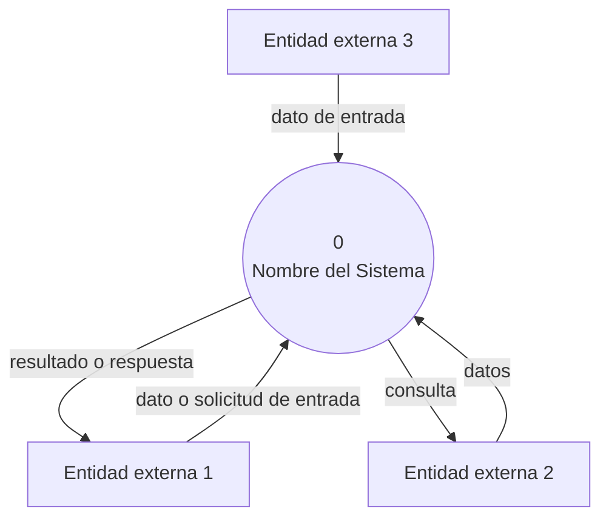
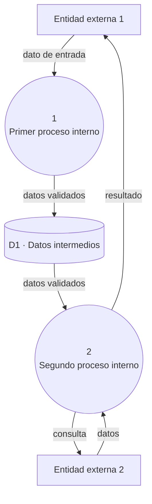
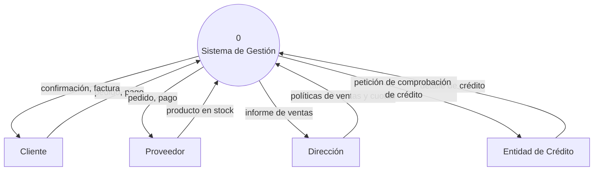
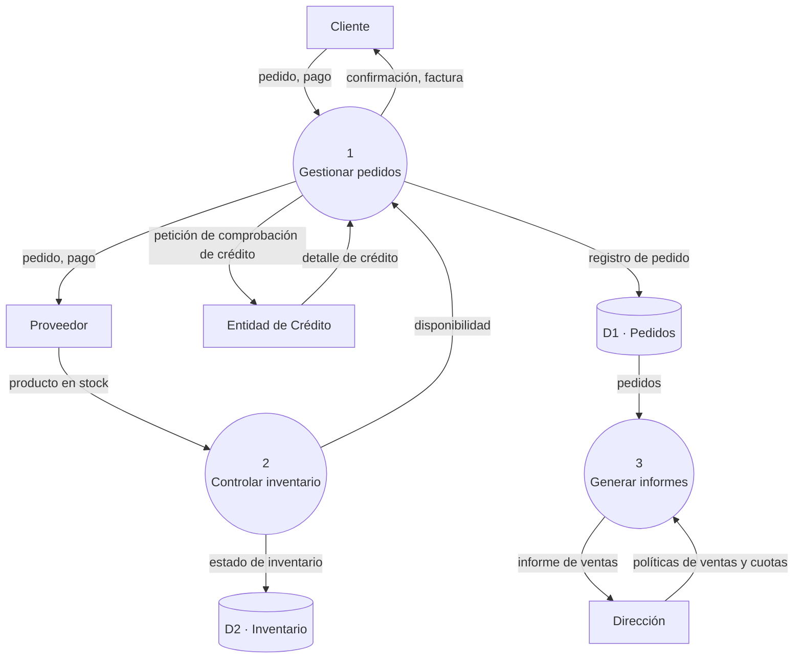

# Instructivo — Diagrama de Flujo de Datos (DFD): Contexto y Descomposición en Niveles

**Aplica a:** TP1 (Semana 2) y como referencia para cualquier TP posterior que necesite ubicar un sistema en su entorno o descomponer su funcionalidad.

Adaptado del material de cátedra sobre Diagramas de Flujo de Datos (DFD).

## 1. Qué es un DFD

Un DFD es una representación gráfica del flujo de datos a través de un sistema, organizada en **niveles sucesivos de detalle**. El nivel más general es el **diagrama de contexto (Nivel 0)**: todo el sistema representado como un único proceso, junto con sus entidades externas y los flujos de datos entre ambos — sin procesos internos ni almacenes.

A partir de ahí, el sistema se puede **descomponer tantos niveles como haga falta**: cada proceso de un nivel puede expandirse en un diagrama propio que muestra sus procesos internos (Nivel 1), y cada uno de esos procesos, si todavía no es lo bastante simple, se puede volver a descomponer (Nivel 2, Nivel 3...). No hay un número de niveles fijo — se baja tanto como el **nivel de atomicidad** del entendimiento inicial lo requiera: se deja de descomponer un proceso cuando ya representa una única transformación lógica clara, o cuando alcanza el nivel de detalle que la actividad necesita.

Regla clave del Nivel 0: **un solo proceso, numerado 0**, y sus terminadores alrededor. A partir de Nivel 1, cada proceso interno recibe su propio número (o su numeración jerárquica, ver sección 3).

## 2. Simbología

| Elemento | Qué representa | Forma clásica | Aparece desde |
|---|---|---|---|
| **Proceso** | Una transformación de datos — el sistema completo en Nivel 0, o una función interna en niveles siguientes | Círculo/burbuja | Nivel 0 |
| **Entidad externa (terminador)** | Persona, organización u otro sistema que interactúa con el sistema, pero no forma parte de él | Rectángulo | Nivel 0 |
| **Flujo de datos** | Datos en movimiento entre un proceso, un almacén o una entidad externa | Flecha etiquetada | Nivel 0 |
| **Almacén** | Datos en reposo (base de datos, archivo, estructura intermedia) | Dos líneas paralelas (en Mermaid se aproxima con forma de cilindro, ver secc. 4) | Nivel 1 en adelante |

## 3. Reglas de construcción

- **Nombres significativos**: cada proceso se nombra con verbo + objeto ("Cargar y validar datos", no "Sistema" ni "Procesar"). Los terminadores, con sustantivos concretos ("Investigador/a", no "Usuario genérico").
- **Numeración jerárquica**: el proceso de contexto siempre es el **0**. Al descomponerlo en Nivel 1, sus procesos internos se numeran 1, 2, 3... Si alguno de esos procesos se vuelve a descomponer, sus procesos internos heredan el número del padre (el proceso 2 se descompone en 2.1, 2.2, 2.3...), y así sucesivamente.
- **Regla de balanceo (balancing)**: los flujos de datos que cruzan el límite del sistema hacia una entidad externa tienen que **coincidir exactamente** entre un nivel y el diagrama que lo descompone — no se puede perder, inventar ni renombrar un flujo externo al bajar de nivel. Los procesos internos pueden repartirse esos flujos entre sí, pero la suma vista desde afuera tiene que ser la misma.
- **Regla de parada (atomicidad)**: no hace falta descomponer todo el sistema a la misma profundidad. Se sigue bajando de nivel solo en los procesos que interesa entender mejor — el resto puede quedarse en un nivel más alto si no es prioritario en esta etapa.
- **No sobrecargar cada diagrama**: en cualquier nivel, entre 4 y 9 elementos (procesos + entidades externas) es razonable — si hay más, probablemente conviene revisar si todos son relevantes al alcance del TP, o si ese proceso amerita bajar un nivel más para separarlos con claridad.
- **Consistencia lógica**: cada flujo tiene que tener sentido (si el sistema recibe datos de una fuente y esa fuente espera algo a cambio, ese flujo también debe estar). Evitar flujos sin etiqueta.
- **Todo terminador se conecta a un proceso, nunca a otro terminador directamente**: la interacción entre entidades externas, si existe, queda fuera del sistema y no se modela.

## 4. Plantilla en Mermaid — Nivel 0 (contexto)

Mermaid no tiene un tipo de diagrama DFD nativo, pero sus formas de nodo alcanzan para representar la simbología correctamente: círculo para el proceso, rectángulo para terminadores, flechas etiquetadas para los flujos.



## 5. Plantilla en Mermaid — Nivel 1 (descomposición)

Para los almacenes se usa la forma de cilindro que ofrece Mermaid (`id[(texto)]`) — es la aproximación visual más cercana a las dos líneas paralelas clásicas del DFD, con la misma salvedad que en cualquier notación aproximada con esta herramienta: representa la idea correctamente, no es el símbolo UML/DFD exacto.



Noten cómo los flujos que cruzan el límite del sistema (`T1`↔proceso, `T2`↔proceso) son los **mismos** que en el diagrama de contexto — eso es la regla de balanceo en la práctica.

## 6. Ejemplo de referencia completo (Nivel 0 → Nivel 1)

Basado en un sistema de gestión, adaptado con nombres genéricos (el original usa un sistema de pedidos e inventario).

**Nivel 0:**



**Nivel 1** — descomposición del proceso 0 en sus tres procesos internos principales, preservando (balanceando) los ocho flujos externos de arriba:



Si en TP1 el grupo decide profundizar específicamente el proceso 1 (por ejemplo, porque es el que van a desarrollar en detalle — ver secc. 4.6 de la guía de TP1), ahí recién correspondería un Nivel 2 descomponiendo el proceso 1 en 1.1, 1.2, 1.3... — el resto de los procesos (2 y 3) puede quedarse en Nivel 1 sin bajar más, si no es prioritario en esta etapa.

## 7. Relación con el modelo C4 (TP3)

El DFD y el modelo C4 no compiten por el mismo lugar: el DFD descompone **funcionalidad y flujo de datos** (qué hace el sistema, con qué información) durante la etapa de requerimientos — es lo que se usa en este TP1. El modelo C4, en el TP3, descompone **arquitectura técnica** (contenedores, componentes, tecnología concreta) una vez que ya se sabe qué tiene que hacer el sistema. Son dos descomposiciones de propósito distinto sobre el mismo sistema, en momentos distintos del proyecto — no hace falta elegir entre una y otra.

## 8. Checklist antes de commitear el diagrama

- [ ] El diagrama de contexto tiene un único proceso, numerado 0.
- [ ] Si hay niveles de descomposición, la numeración de procesos es jerárquica (1, 2, 3... y sus hijos 1.1, 1.2... si corresponde).
- [ ] Los flujos que cruzan el límite del sistema coinciden exactamente entre cada nivel y el que lo descompone (balanceo).
- [ ] Los almacenes solo aparecen desde Nivel 1 en adelante, nunca en el diagrama de contexto.
- [ ] Todas las entidades externas, procesos, almacenes y flujos tienen nombre significativo. No hay flujos sin etiqueta.
- [ ] Todo terminador se conecta únicamente a procesos, nunca a otro terminador ni directamente a un almacén.
- [ ] No se descompuso más de lo necesario: los procesos que no son prioritarios para este TP pueden quedarse en un nivel más alto.
- [ ] El diagrama está en un bloque ` ```mermaid ` dentro de un `.md` del repositorio, no como imagen.

---

*Instructivo de la unidad curricular Ingeniería de Software — FIUNER. Adaptado del material de cátedra sobre Diagramas de Flujo de Datos.*
