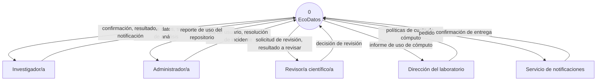
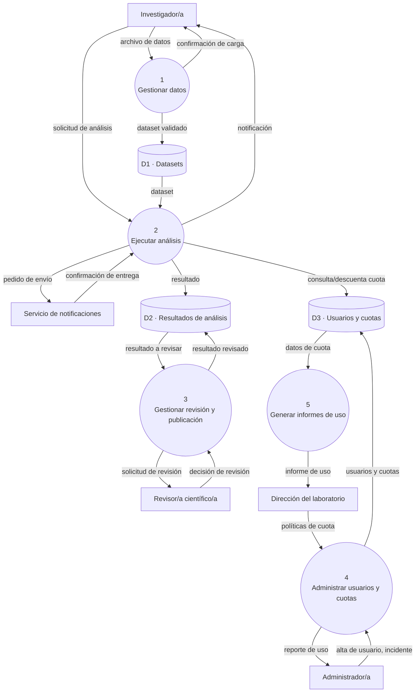
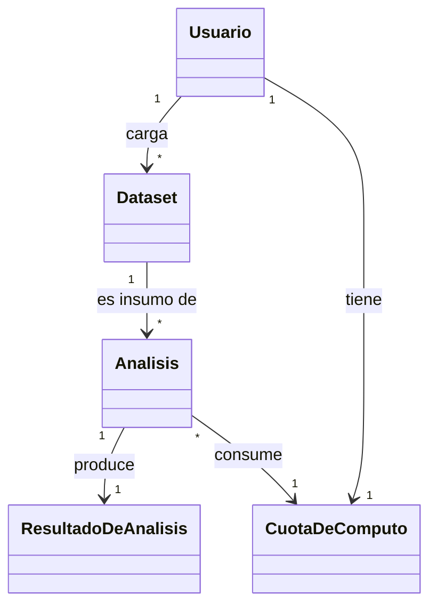

# Ejemplo resuelto de TP1 — "EcoDatos"

> **Qué es este documento.** Un ejemplo completo, de punta a punta, de cómo un grupo podría resolver el TP1 siguiendo la guía (`tp1-requerimientos.md`). Usa un proyecto ficticio ("EcoDatos") para mostrar el nivel de detalle esperado en cada artefacto — desde el problema hasta la trazabilidad completa RF → CU → slice → HU. No es una plantilla para copiar tal cual: cada grupo tiene su propio dominio, sus propios procesos y sus propias decisiones de alcance.

| | |
|---|---|
| **Proyecto** | EcoDatos — plataforma de carga y análisis de datos ambientales de campo |
| **Grupo (ficticio)** | Camila Ríos, Tomás Duarte, Lucía Fernández |
| **Modelo de ciclo de vida** | Iterativo-incremental, con prácticas ágiles livianas |

---

## 1. Visión y alcance (canvas de descubrimiento)

**Problema.** Investigadores de un laboratorio ambiental universitario recolectan datos de sensores de campo (temperatura, humedad, calidad de agua y aire) y hoy los comparten en planillas sueltas y carpetas de Drive, sin validación de formato ni control de versiones. Resultado: datasets inconsistentes, análisis no reproducibles, y horas perdidas limpiando datos antes de poder usarlos. El cómputo de análisis pesados (detección de anomalías, tendencias) se hace en notebooks personales, sin capacidad de escalar ni de repartir el recurso compartido del laboratorio entre investigadores.

**Usuarios y stakeholders.**

| Rol | Tipo | Interés |
|---|---|---|
| Investigador/a | Usuario principal | Cargar datos confiables, correr análisis, obtener resultados |
| Administrador/a del sistema | Usuario | Gestionar usuarios/incidentes, cuidar integridad del repositorio |
| Revisor/a científico/a | Usuario | Validar resultados antes de que se publiquen |
| Dirección del laboratorio | Interesado, no usuario directo | Visibilidad del cómputo consumido y lo producido |
| Servicio de notificaciones | Actor secundario (sistema externo) | Entregar avisos por email/plataforma |

**Valor.** Si el sistema funciona, un investigador deja de perder horas limpiando planillas ajenas y puede confiar en que un dataset validado por el sistema está en condiciones de analizarse — y el laboratorio deja de depender de notebooks personales para el cómputo pesado.

**Alcance realista.** En un cuatrimestre, con 2-3 personas, se puede sostener la carga y validación de datos, y un motor de análisis simple con encolado — no un motor de cómputo distribuido real. Queda deliberadamente afuera: integraciones con sensores IoT en tiempo real, y el flujo de revisión/publicación científica (se documenta como extensión, sin desarrollar).

**Riesgo más probable.** Incertidumbre al inicio sobre qué tipos de análisis son realmente representativos del trabajo del laboratorio — se mitiga arrancando con un tipo de análisis (estadístico simple) y agregando los demás una vez validado con investigadores reales.

**Datos sensibles.** Los datasets no contienen datos personales identificables (son mediciones ambientales), pero si en el futuro se incorporan coordenadas de sitios de estudio protegidos, correspondería tratarlas con el mismo cuidado que datos sensibles, restringiendo su publicación pública.

---

## 2. Modelo de ciclo de vida elegido y justificación

**Modelo elegido:** iterativo-incremental, con prácticas ágiles livianas (tablero Kanban, reunión breve semanal).

**Justificación (atributos del proyecto):**

- *Claridad de requerimientos:* media-alta en los procesos elegidos (carga y análisis), pero se espera refinamiento una vez que el grupo pruebe con datos de campo reales — un modelo secuencial no tolera bien ese ajuste tardío.
- *Núcleo mínimo de valor entregable temprano:* sí — la carga y validación de datos (Proceso 1) ya es útil por sí sola, incluso antes de que exista el motor de análisis.
- *Riesgo a gestionar con iteraciones cortas:* el cómputo asíncrono (colas, notificaciones) es la parte más incierta técnicamente — conviene validarla en una iteración chica (el slice B1 de CU-02, ver secc. 6) antes de comprometer el diseño completo del motor de análisis.

---

## 3. Diagrama de contexto (DFD Nivel 0)



## 4. Descomposición funcional (DFD Nivel 1)



Los ocho flujos externos del Nivel 0 están todos presentes acá, repartidos entre los cinco procesos — regla de balanceo.

## 5. Modelo de dominio conceptual



## 6. Selección de proceso(s) a desarrollar en profundidad

El grupo elige **Proceso 1 (Gestionar datos) y Proceso 2 (Ejecutar análisis)** — son el núcleo de valor del proyecto: sin datos confiables no hay análisis posible, y el análisis es la razón de ser del sistema. Quedan fuera de profundidad este cuatrimestre:

- **Proceso 3 (revisión/publicación)** — flujo de gobernanza, no diferencia al producto en su primera versión. Se deja nombrado como extensión (CU-03, secc. 7.2) para el Trabajo Integrador si el grupo decide continuarlo.
- **Proceso 4 (administración)** — gestión de usuarios genérica, de menor prioridad para demostrar el valor central.
- **Proceso 5 (informes)** — depende de que los otros procesos ya generen datos reales de uso; prematuro en este cuatrimestre.

## 7. Requerimientos funcionales

```
RF-01: El sistema debe permitir cargar un archivo de datos en formato CSV o JSON.
RF-02: El sistema debe validar que los datos cargados cumplan formato y rangos del esquema.
RF-03: El sistema debe generar un resumen estadístico del dataset cargado.
RF-04: El sistema debe permitir ejecutar un análisis sobre un dataset ya validado.
RF-05: El sistema debe notificar al investigador/a la finalización de su análisis.
RF-06: El sistema debe limitar el cómputo de análisis según la cuota mensual del investigador/a.
```

---

## 7.1 CU-01 · Cargar archivo de datos de entrada (Proceso 1)

```
Actor principal: Investigador/a
Realiza: RF-01, RF-02, RF-03

Interesados e intereses:
  - Investigador/a: cargar sus datos rápido y saber si están en condiciones de analizarse.
  - Administrador/a del sistema: que no se acepten datos que comprometan el repositorio.

Precondición: el/la investigador/a está autenticado/a y tiene un archivo en su equipo.
Disparador: el/la investigador/a decide cargar un nuevo conjunto de datos.
Garantía de éxito: el archivo queda almacenado, validado, disponible para análisis,
  y el investigador/a tiene un resumen de lo cargado.
Garantía mínima: el sistema nunca deja datos parcialmente almacenados ni corrompe
  el repositorio.

Flujo principal:
  1. El/la investigador/a selecciona el archivo a cargar.
  2. El sistema valida que el formato sea uno de los soportados (CSV, JSON).
  3. El sistema valida que los datos cumplan los rangos y tipos del esquema.
  4. El sistema almacena el archivo validado en el repositorio.
  5. El sistema calcula un resumen estadístico del conjunto de datos.
  6. El sistema confirma la carga exitosa y muestra el resumen.

Flujos alternativos (nombrados):
  - A1: el archivo tiene formato inválido (diverge en el paso 2).
  - A2: el archivo está vacío o sin registros (diverge en el paso 2).
  - A3: el investigador/a cancela antes de confirmar (diverge en el paso 1).

Flujos de excepción (nombrados):
  - E1: se interrumpe la conexión durante la carga (pasos 1-4).
  - E2: el repositorio no tiene espacio disponible (paso 4).
```

**Slices** — el básico se subdivide por prioridad/valor, y A1 se subdivide por mecanismo de detección:

```
CU-01
  Slice B1 (básico, parte 1) — pasos 1-4: carga + validación + almacenamiento
  Slice B2 (básico, parte 2) — pasos 5-6: resumen estadístico
  Slice A1.1 — extensión de archivo no soportada (se detecta antes de leer el contenido)
  Slice A1.2 — contenido corrupto pese a extensión válida (se detecta al parsear)
  Slice A2 — archivo vacío                — nombrado, sin desarrollar
  Slice A3 — cancelación                  — nombrado, sin desarrollar
  Slice E1 — conexión interrumpida        — nombrado, sin desarrollar
  Slice E2 — repositorio sin espacio      — nombrado, sin desarrollar
```

### Historias de usuario de CU-01

```
HU-01.B1a · Carga y validación (investigador/a)
Deriva de: CU-01, slice B1
Como investigador/a,
quiero cargar y validar mi archivo de datos,
para tener la certeza de que están listos para analizarse.

Criterios de aceptación:
- Given un archivo CSV con datos dentro de los rangos esperados,
  When el investigador/a lo carga,
  Then el sistema lo almacena y confirma "carga exitosa".
- Given un archivo CSV con al menos un valor fuera de rango,
  When el investigador/a lo carga,
  Then el sistema rechaza el archivo e indica fila y campo del valor inválido.
```

```
HU-01.B1b · Carga en nombre de otro (administrador/a)
Deriva de: CU-01, slice B1
Como administrador/a del sistema,
quiero cargar un archivo en nombre de un/a investigador/a,
para resolver incidentes de carga reportados por soporte.

Criterios de aceptación:
- Given un archivo válido y un/a investigador/a destinatario/a seleccionado/a,
  When el administrador/a lo carga,
  Then el sistema lo asocia al investigador/a destinatario/a (no al administrador/a)
  y registra en el log de auditoría quién ejecutó la carga.

Nota del grupo: se evaluó si esto debía ser un slice separado en vez de una
segunda HU del mismo slice B1 — se decidió que no, porque la postcondición
central (datos validados y almacenados) es idéntica; lo que cambia es
metadata incidental del actor (propiedad, auditoría), no el mecanismo de carga.
```

```
HU-01.B2 · Resumen estadístico
Deriva de: CU-01, slice B2
Como investigador/a,
quiero ver un resumen estadístico del archivo recién cargado,
para tener una primera idea de mis datos sin abrir otra herramienta.

Criterios de aceptación:
- Given un archivo cargado y validado exitosamente,
  When finaliza la carga,
  Then el sistema muestra cantidad de registros, cantidad de columnas,
  y estadísticas descriptivas (mínimo, máximo, promedio) por columna numérica.
- Given un archivo con columnas no numéricas,
  When se genera el resumen,
  Then esas columnas se listan con su cantidad de valores únicos, sin
  intentar calcular estadísticas numéricas sobre ellas.
```

```
HU-01.A1.1 · Extensión no soportada
Deriva de: CU-01, slice A1.1
Como investigador/a,
quiero que el sistema rechace de inmediato un archivo con extensión no soportada,
para corregirlo sin cargarlo de nuevo a ciegas.

Criterios de aceptación:
- Given un archivo con extensión .xlsx,
  When el investigador/a intenta cargarlo,
  Then el sistema lo rechaza antes de leer el contenido y muestra
  "Formato no soportado. Formatos válidos: CSV, JSON".
```

```
HU-01.A1.2 · Contenido corrupto
Deriva de: CU-01, slice A1.2
Como investigador/a,
quiero que el sistema indique en qué fila detectó un problema de formato interno,
para poder corregirlo puntualmente.

Criterios de aceptación:
- Given un archivo .csv con separador de columnas inconsistente en la fila 47,
  When el investigador/a lo carga,
  Then el sistema rechaza la carga e indica
  "Error de formato en la fila 47: número de columnas inesperado".
```

---

## 7.2 CU-02 · Analizar conjunto de datos cargado (Proceso 2)

```
Actor principal: Investigador/a
Actor secundario: Sistema de notificaciones
Realiza: RF-04, RF-05, RF-06
Incluye (<<include>>): CU-00 · Verificar cuota de cómputo disponible
  (se factoriza como CU aparte porque también lo usan otras funciones
  de la plataforma que consumen cómputo — evita repetir la lógica).

Precondición: hay al menos un dataset cargado y validado (postcondición de CU-01).
Disparador: el investigador/a selecciona un dataset y un tipo de análisis.

Flujo principal:
  1. El investigador/a selecciona dataset y tipo de análisis (estadístico,
     detección de anomalías, tendencia temporal).
  2. El sistema verifica cuota de cómputo disponible <<include>> CU-00.
  3. El sistema encola el análisis y confirma tiempo estimado.
  4. El sistema ejecuta el análisis de forma asincrónica.
  5. El sistema almacena el resultado y descuenta la cuota utilizada.
  6. El sistema notifica al investigador/a la finalización, con resumen.

Punto de extensión (<<extend>>): tras el paso 6, si el investigador/a marca
  el resultado como "para publicar" (no uso privado), se extiende con
  CU-03 · Solicitar revisión científica (actor: Revisor/a científico/a) —
  no se desarrolla este cuatrimestre (ver secc. 6).

Flujos alternativos: A1 cuota insuficiente (dentro de CU-00, diverge en el
  paso 2) · A2 el investigador/a cancela mientras está en cola (diverge en
  los pasos 3-4) · A3 parámetros de análisis fuera de rango (diverge en el
  paso 1).
Flujos de excepción: E1 falla de cómputo — timeout o memoria (paso 4) ·
  E2 falla al notificar (paso 6) · E3 se agota la cuota a mitad de un
  análisis largo (pasos 4-5 — distinto de A1: A1 se detecta ANTES de
  empezar, E3 DURANTE la ejecución).
```

**Slices** — el básico se subdivide por la frontera síncrona/asíncrona (lo que el investigador ve de inmediato vs. lo que pasa en segundo plano):

```
CU-02
  Slice B1 — pasos 1-3: seleccionar, verificar cuota, encolar y confirmar
  Slice B2 — pasos 4-6: ejecutar, almacenar, notificar
  Slice A2 — cancelación en cola
  Slice E3 — cuota agotada a mitad de análisis
  Slice A1 — cuota insuficiente         — nombrado, sin desarrollar
  Slice A3 — parámetros fuera de rango  — nombrado, sin desarrollar
  Slice E1 — falla de cómputo           — nombrado, sin desarrollar
  Slice E2 — falla de notificación      — nombrado, sin desarrollar
```

### Historias de usuario de CU-02

```
HU-02.B1 · Encolar análisis
Deriva de: CU-02, slice B1
Como investigador/a,
quiero encolar un análisis sobre mi dataset y saber cuánto va a tardar,
para poder seguir trabajando en otra cosa mientras se procesa.

Criterios de aceptación:
- Given un dataset validado y cuota de cómputo suficiente,
  When el investigador/a confirma el análisis,
  Then el sistema lo encola y muestra un tiempo estimado.
- Given cuota de cómputo insuficiente para el análisis elegido,
  When el investigador/a intenta confirmarlo,
  Then el sistema rechaza la solicitud e indica cuánta cuota le queda
  y cuánta necesita.
```

```
HU-02.B2 · Notificar resultado del análisis
Deriva de: CU-02, slice B2
Como investigador/a,
quiero recibir un aviso cuando mi análisis termine, con un resumen del resultado,
para no tener que estar revisando el sistema manualmente.

Criterios de aceptación:
- Given un análisis que terminó exitosamente,
  When se genera el resultado,
  Then el sistema notifica al investigador/a con un resumen y descuenta
  la cuota utilizada.
- Given un análisis que falló por timeout,
  When se agota el tiempo máximo de ejecución,
  Then el sistema notifica al investigador/a el motivo de la falla sin
  descontar cuota de cómputo.
```

```
HU-02.A2 · Cancelar análisis en cola
Deriva de: CU-02, slice A2
Como investigador/a,
quiero poder cancelar un análisis mientras todavía está en cola,
para no gastar cuota de cómputo en un análisis que ya no necesito.

Criterios de aceptación:
- Given un análisis en estado "en cola" (todavía no empezó a ejecutarse),
  When el investigador/a lo cancela,
  Then el sistema lo quita de la cola sin descontar cuota.
- Given un análisis que ya pasó a estado "ejecutando",
  When el investigador/a intenta cancelarlo,
  Then el sistema informa que ya no se puede cancelar en este punto.
```

```
HU-02.E3 · Cuota agotada a mitad de análisis
Deriva de: CU-02, slice E3
Como investigador/a,
quiero que un análisis interrumpido por falta de cuota a mitad de camino no
me deje en un estado inconsistente,
para no perder tiempo de cómputo sin obtener ningún resultado utilizable.

Criterios de aceptación:
- Given un análisis que consume cuota progresivamente y la cuota se agota
  antes de terminar,
  When el sistema detecta que no hay cuota suficiente para continuar,
  Then detiene el análisis, no descuenta más cuota de la ya consumida, y
  notifica al investigador/a que el análisis quedó incompleto por cuota
  insuficiente.
```

> **Nota del grupo sobre E2** (falla de notificación): el Given de ese slice describe una falla del sistema de notificaciones, un actor no humano — al momento de desarrollarlo, evaluar si conviene forzarlo al formato "Como [actor], quiero..." o especificarlo directamente como requerimiento técnico sin el molde de historia de usuario.

> **Nota de diseño sobre RF-06 (fuera de alcance de TP1).** `RF-06` dice *qué* tiene que pasar ("limitar el cómputo según la cuota"), deliberadamente sin decir *cómo* se mide — eso es una decisión de TP3/TP4, no del SRS. Dos caminos posibles, evaluados por el grupo para más adelante: (a) costo estimado por tipo de análisis (una tabla fija de "unidades de cómputo" por tipo, simple y predecible), o (b) medición real de recursos consumidos (más precisa, exige instrumentar el motor de análisis). Cualquiera de las dos formas tiene que resolver, además, que dos solicitudes casi simultáneas del mismo investigador/a no descuenten ambas sobre la misma cuota restante — ese requisito sí se deja escrito ahora, como escenario de calidad (ver secc. 8, escenario de Fiabilidad en entorno degradado), sin comprometerse todavía con el mecanismo (transacción, bloqueo, etc.) que lo va a resolver.

---

## 8. Atributos de calidad — escenarios (ISO 25010)

Cada escenario se redacta con los seis campos de la técnica (fuente del estímulo, estímulo, entorno, artefacto, respuesta, medida de respuesta), cubriendo más de una condición de entorno por atributo — normal, sobrecarga y degradado.

### Fiabilidad — Tolerancia a fallos

**Escenario 1 — entorno normal**

| Campo | Contenido |
|---|---|
| Fuente del estímulo | Investigador/a |
| Estímulo | Solicita un análisis sobre un dataset de 500 MB |
| Entorno | Operación normal (menos de 20 análisis concurrentes en el sistema) |
| Artefacto | Módulo de ejecución de análisis (Proceso 2) |
| Respuesta | El sistema detecta que no puede completar el análisis por falta de cómputo, lo aborta de forma controlada y notifica al investigador/a, sin corromper el dataset ni la cuota |
| Medida de respuesta | 100% de los análisis fallidos dejan dataset y cuota en estado consistente, verificable por auditoría |

**Escenario 2 — entorno de sobrecarga**

| Campo | Contenido |
|---|---|
| Fuente del estímulo | Múltiples investigadores/as |
| Estímulo | Cargan datasets y solicitan análisis simultáneamente (fin de una campaña de campo) |
| Entorno | Pico de uso — hasta 50 solicitudes simultáneas |
| Artefacto | Cola de análisis y módulo de carga de datos (Procesos 1 y 2) |
| Respuesta | El sistema encola todas las solicitudes sin perder ninguna y sin bloquear nuevas cargas de datos |
| Medida de respuesta | 0% de solicitudes perdidas con hasta 50 solicitudes simultáneas |

**Escenario 3 — entorno degradado (alta concurrencia sobre el mismo recurso)**

| Campo | Contenido |
|---|---|
| Fuente del estímulo | Dos solicitudes de análisis del mismo investigador/a, o de distintos investigadores compitiendo por el cómputo del laboratorio |
| Estímulo | Llegan casi simultáneamente cuando la cuota restante del investigador/a alcanza para una sola de las dos |
| Entorno | Degradado — alta concurrencia sobre el mismo registro de cuota |
| Artefacto | Módulo de verificación y descuento de cuota (CU-00, incluido por CU-02) |
| Respuesta | El sistema aprueba una sola de las dos solicitudes y rechaza la otra por cuota insuficiente — ninguna combinación de solicitudes concurrentes puede descontar más de lo que la cuota restante permite |
| Medida de respuesta | 0% de casos en que la cuota consumida supere la cuota asignada, bajo una prueba de concurrencia con al menos 10 solicitudes simultáneas sobre el mismo usuario |

### Eficiencia de desempeño — Comportamiento temporal

**Escenario 1 — entorno normal**

| Campo | Contenido |
|---|---|
| Fuente del estímulo | Investigador/a |
| Estímulo | Carga un archivo de hasta 50 MB |
| Entorno | Operación normal (sin otras cargas concurrentes) |
| Artefacto | Módulo de carga y validación (Proceso 1) |
| Respuesta | El sistema valida formato y rangos del archivo |
| Medida de respuesta | Se completa en menos de 10 segundos |

**Escenario 2 — entorno de sobrecarga**

| Campo | Contenido |
|---|---|
| Fuente del estímulo | Investigador/a (uno entre varios) |
| Estímulo | Carga un archivo de hasta 50 MB |
| Entorno | Uso pico — 10 cargas concurrentes de otros investigadores en simultáneo |
| Artefacto | Módulo de carga y validación (Proceso 1) |
| Respuesta | El sistema valida formato y rangos del archivo |
| Medida de respuesta | Se completa en menos de 30 segundos |

---

## 9. Trazabilidad completa

```
RF-01, RF-02, RF-03
  └─ CU-01 · Cargar archivo de datos de entrada  (Proceso 1)
       ├─ Slice B1 → HU-01.B1a, HU-01.B1b
       ├─ Slice B2 → HU-01.B2
       ├─ Slice A1.1 → HU-01.A1.1
       ├─ Slice A1.2 → HU-01.A1.2
       └─ A2, A3, E1, E2 — nombrados, sin desarrollar

RF-04, RF-05, RF-06
  └─ CU-02 · Analizar conjunto de datos cargado  (Proceso 2)
       ├─ Incluye: CU-00 · Verificar cuota de cómputo
       ├─ Extiende (condicional): CU-03 · Solicitar revisión científica
       ├─ Slice B1 → HU-02.B1
       ├─ Slice B2 → HU-02.B2
       ├─ Slice A2 → HU-02.A2
       ├─ Slice E3 → HU-02.E3
       └─ A1, A3, E1, E2 — nombrados, sin desarrollar
```

---

*Ejemplo de referencia de la unidad curricular Ingeniería de Software — FIUNER. Proyecto y datos ficticios, con fines exclusivamente didácticos.*
