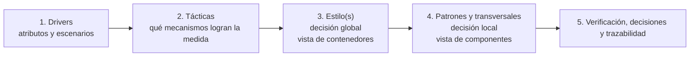
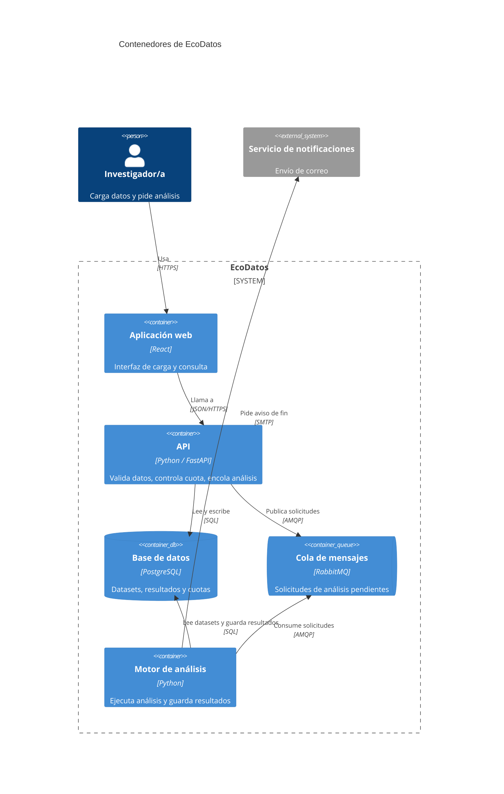
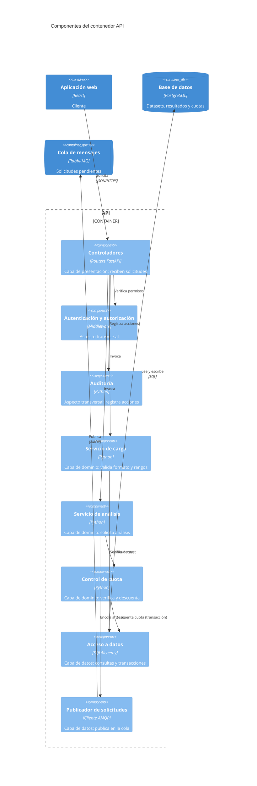
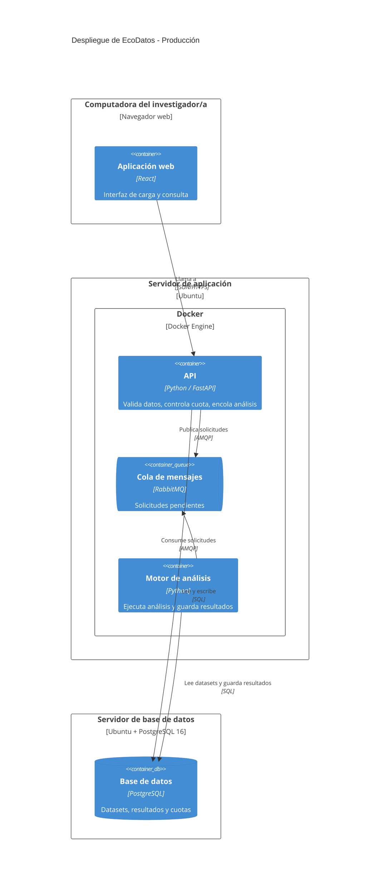

# Ingeniería del Software - 2026 - TP 3

## Arquitectura del Sistema

---

## 1. Objetivos de aprendizaje

Al finalizar este trabajo práctico, el grupo deberá ser capaz de:

- Comprender la arquitectura como un conjunto de decisiones de diseño estructurales, guiadas por atributos de calidad, y distinguirla del diseño detallado.
- Identificar, entre los escenarios de atributo de calidad del TP2, los que más condicionan la estructura del sistema (drivers arquitectónicos).
- Distinguir táctica, estilo y patrón arquitectónico, y el nivel de decisión que corresponde a cada uno.
- Recorrer el camino que va de los escenarios a las tácticas, de las tácticas al estilo y de este a los patrones, justificando lo que cada elección mejora y lo que sacrifica.
- Reconocer cuándo una arquitectura combina varios estilos y justificar cada combinación.
- Considerar los aspectos transversales (seguridad, gestión operativa y comunicación) que atraviesan la solución.
- Representar la arquitectura con las vistas de **contenedores**, de **componentes** y de **despliegue** del modelo C4, aplicando las reglas de construcción de cada una, en Mermaid.
- Documentar las decisiones y las vistas en un **Documento de Especificación de Arquitectura**.
- Mantener la trazabilidad entre escenario, táctica, estilo o patrón, decisión, elemento del modelo C4 e historia de usuario.
- Utilizar inteligencia artificial (IA) como apoyo para evaluar alternativas de arquitectura, ejerciendo el criterio propio del equipo y documentando el proceso.

---

## 2. Modalidad de trabajo

Este TP es continuación directa del proyecto desarrollado en el TP1 y el TP2. No se cambia de proyecto ni de alcance.

La arquitectura se define para el o los procesos elegidos en el TP1. El resto del sistema se representa como caja negra: como sistema externo o como contenedor sin detalle interno.

**Alcance de este TP.** El foco está en las vistas de contenedores y de componentes, más un diagrama de despliegue del entorno de producción. La vista de clases y de código **no se trabaja en este TP**.

El trabajo se organiza en dos partes que se retroalimentan, ambas obligatorias:

- Parte A: De los atributos de calidad a la elección de estilos y patrones.
- Parte B: Representación de la arquitectura en contenedores, componentes y despliegue.

Todo el resultado se reúne en un único documento. Recomendación: el trabajo se realiza en una rama del repositorio y se integra mediante Pull Request con revisión cruzada del grupo, según el instructivo de Git y GitHub.

---

## 3. Parte A: De los atributos de calidad a la arquitectura

### 3.1 Visión general

La arquitectura se **deriva** de los atributos de calidad. El grupo recorre cinco pasos, y en cada uno la decisión se vuelve más concreta:



| Paso | Pregunta que responde | Resultado |
|---|---|---|
| 1. Drivers | ¿Qué escenarios condicionan la estructura? | Lista de drivers con identificador |
| 2. Tácticas | ¿Qué mecanismos permiten alcanzar la medida de respuesta? | Tácticas elegidas y descartadas por driver |
| 3. Estilo(s) | ¿Cómo se organiza el sistema en su conjunto? | Estilo base y, si corresponde, estilos adicionales para ciertas zonas. Primera versión de la vista de contenedores |
| 4. Patrones y aspectos transversales | ¿Cómo se resuelve cada problema puntual dentro de un contenedor y qué atraviesa toda la solución? | Patrones por contenedor y aspectos transversales adoptados. Primera versión de la vista de componentes |
| 5. Verificación | ¿Cada escenario queda cubierto? | Tabla de cobertura, decisiones de arquitectura y trazabilidad |

### 3.2 Táctica, estilo y patrón: qué los diferencia

Estos tres conceptos se usan en niveles de decisión distintos:

- Una **táctica** es una decisión de diseño elemental que influye en el logro de la respuesta de un escenario de calidad. Es la unidad más chica. Ejemplo: introducir concurrencia.
- Un **estilo** arquitectónico es un conjunto de principios que da un marco abstracto para toda una familia de sistemas: define el vocabulario de componentes y conectores que se pueden usar y las restricciones sobre cómo se combinan. Responde a la pregunta *¿cómo se organiza el sistema en su conjunto?* Es la primera decisión de diseño. Ejemplos: cliente-servidor, repositorio, orientada a eventos.
- Un **patrón** arquitectónico es una solución concreta y reutilizable a un problema recurrente, dentro de un contexto particular, con las consideraciones que afectan la decisión. Responde a la pregunta *¿cómo resuelvo este problema puntual?* Puede aplicarse dentro de uno o más estilos. Ejemplos: MVC (Modelo-Vista-Controlador), hexagonal, capas.

Los estilos y patrones ofrecen estructuras donde se pueden aplicar varias tácticas, pero no las garantizan: elegir cliente-servidor no da alta disponibilidad por sí solo, porque además hacen falta, por ejemplo, redundancia y detección de fallos. Las tácticas se seleccionan y se concretan en decisiones de arquitectura; el estilo o el patrón es la estructura que facilita aplicarlas. Cada elección mejora ciertos atributos y suele costar algo en otro, y por eso las tablas de este TP indican, para cada estilo o patrón, **qué sacrifica**.

Regla práctica: el estilo organiza el sistema entero, por lo que **se hace visible sobre todo en la vista de contenedores**. El patrón resuelve un problema dentro de una aplicación, por lo que **se hace visible en la vista de componentes**. Es una orientación, no una regla fija: lo que decide en qué vista se ve una decisión es si separa procesos o solo organiza el interior de uno. Un estilo como tuberías y filtros puede existir dentro de un único proceso, y entonces se ve en componentes; algunos patrones, como el broker, introducen piezas que se ejecutan por separado y por eso también aparecen en la vista de contenedores. Las tácticas que dependen de la infraestructura (réplicas, más recursos, separación de servidores) suelen hacerse visibles en la vista de despliegue.

### 3.3 Paso 1 — Drivers arquitectónicos

El grupo parte de los atributos y escenarios del TP2 (recordar: en ISO/IEC 25010:2023 el atributo elegido es la subcaracterística) y determina cuáles son **drivers arquitectónicos**: los escenarios cuyo cumplimiento condiciona la estructura del sistema, es decir, la elección de estilo, la división en contenedores o componentes, o la incorporación de mecanismos como colas, réplicas o transacciones.

No todo escenario es un driver. Uno que se resuelve dentro de un único componente, o solo en la interfaz de usuario, sin afectar la estructura, no lo es.

Cada escenario del TP2 recibe un identificador para poder trazarlo: `EC-01`, `EC-02`, y así sucesivamente (EC significa *escenario de calidad*). El grupo explica por qué cada driver condiciona la estructura y considera además los requerimientos funcionales y las historias de usuario del TP1, y las restricciones reales del proyecto: tamaño del equipo, tiempo disponible y tecnologías que ya domina.

### 3.4 Paso 2 — Tácticas

Una táctica es una decisión de diseño que ayuda a lograr la respuesta de un escenario de calidad. Las tácticas de esta guía se agrupan según los atributos de calidad que desarrolla el libro *Software Architecture in Practice* (Bass, Clements y Kazman). La Tabla 1 indica la correspondencia de cada uno de esos atributos con las subcaracterísticas de ISO/IEC 25010:2023, y la Tabla 2 explica cada táctica en palabras simples.

Para cada driver, el grupo:

1. Ubica su subcaracterística en la Tabla 1 y toma el atributo que le corresponde. Si no tiene correspondencia, lo indica y la ubica en el atributo más cercano.
2. Revisa en la Tabla 2 las tácticas de ese atributo y selecciona las que le permiten alcanzar la medida de respuesta del escenario. Explica cómo contribuye cada una.
3. Indica las que descartó y por qué.

Si el grupo propone una táctica que no está en la tabla, lo aclara. Una táctica es una decisión, no una tecnología: "introducir concurrencia" es una táctica; "usar RabbitMQ" es una tecnología.

**Tabla 1.** Relaciona cada atributo del libro con las subcaracterísticas de ISO/IEC 25010:2023 que le corresponden y con los estilos y patrones candidatos (el detalle de estos últimos está en las Tablas 3 y 5). Es una propuesta: el grupo puede plantear otras combinaciones si las justifica.

| Atributo (libro) | Correspondencia con ISO/IEC 25010:2023 | Estilos candidatos | Patrones candidatos |
|---|---|---|---|
| **Disponibilidad** | Fiabilidad: ausencia de fallos, disponibilidad, tolerancia a fallos, capacidad de recuperación | Cliente-servidor (servidor replicado); repositorio (transacciones); orientada a eventos; microservicios | Broker (intermediario de mensajes, con reintento); capas (aislar funciones críticas) |
| **Desempeño** | Eficiencia de desempeño: comportamiento temporal, utilización de recursos, capacidad | Cliente-servidor (balanceo); tuberías y filtros; repositorio (caché, réplicas de lectura); orientada a eventos; microservicios; monolítica (si prima reducir la comunicación) | CQRS (separación de responsabilidades entre comandos y consultas); broker |
| **Seguridad** | Seguridad de la información: confidencialidad, integridad, no repudio, responsabilidad, autenticidad, resistencia | Cliente-servidor (control centralizado); repositorio (permisos y auditoría centralizados); microservicios (aislamiento) | Capas (control en la capa de servicios). Aspectos transversales: autenticación, autorización, roles, auditoría |
| **Modificabilidad** | Mantenibilidad: modularidad, reusabilidad, analizabilidad, modificabilidad | Microservicios; orientada a eventos; microkernel | Capas; hexagonal; MVC; MVVM (Modelo-Vista-Modelo de Vista); broker |
| **Capacidad de prueba** | Mantenibilidad: capacidad de prueba | Tuberías y filtros (cada filtro se prueba por separado); microservicios | Capas; hexagonal; MVC |
| **Usabilidad** | Capacidad de interacción: capacidad de aprendizaje, operabilidad, protección frente a errores del usuario, asistencia al usuario, autodescriptividad | Cliente-servidor; orientada a eventos (la cancelación como evento) | MVC; MVVM |
| **Interoperabilidad** | Compatibilidad: interoperabilidad | Cliente-servidor (con APIs REST: interfaces web basadas en HTTP, el protocolo de la web); microservicios; orientada a eventos; SOA (arquitectura orientada a servicios) | Hexagonal (adaptadores); broker. Aspectos transversales: interoperabilidad, notificaciones |

**Subcaracterísticas de ISO/IEC 25010:2023 sin correspondencia en el libro:**

- Escalabilidad, coexistencia, instalabilidad, adaptabilidad y reemplazabilidad: no tienen atributo propio. El grupo las ubica en el atributo más cercano (por ejemplo, escalabilidad se trabaja con las tácticas de desempeño) y lo justifica en la decisión que corresponda.
- Completitud, corrección y pertinencia funcional: son subcaracterísticas de calidad y el grupo pudo haberlas elegido en el TP2, pero sus escenarios rara vez condicionan la estructura del sistema. Si el escenario no lo hace, no es un driver; se verifica con los criterios de aceptación de las historias de usuario.
- Reconocibilidad de la adecuación, compromiso del usuario e inclusividad: se resuelven sobre todo en la interfaz (TP2). Si el escenario no condiciona la estructura, no es un driver.

**Tabla 2. Tácticas explicadas.**

**Tabla 2a. Disponibilidad** — que el sistema funcione cuando se lo necesita y se recupere de las fallas.

| Grupo | Táctica | En palabras simples | Ejemplo |
|---|---|---|---|
| Detectar fallos | Monitoreo | Un componente vigila el estado del sistema y avisa si algo anda mal | Un proceso que controla cada minuto que la API responda |
| Detectar fallos | Latido | Un componente envía una señal periódica que dice "sigo funcionando"; si la señal deja de llegar, se asume que falló | El motor de análisis avisa cada 10 segundos que está activo |
| Detectar fallos | Ping y eco | Un componente le pregunta a otro si está activo y espera su respuesta | La API consulta si la base de datos responde |
| Detectar fallos | Detección de excepciones | El sistema reconoce situaciones anormales cuando ocurren | Detectar que falló la escritura de un archivo |
| Recuperarse | Redundancia (activa, pasiva o de repuesto) | Tener copias de un componente para que, si uno falla, otro tome su lugar. Activa: todas trabajan a la vez. Pasiva: una trabaja y las demás esperan. De repuesto: hay una de reserva que se enciende solo si hace falta | Dos instancias de la API detrás de un balanceador |
| Recuperarse | Reintento | Repetir una operación que falló, por si el problema fue pasajero | Volver a enviar un mensaje que no se pudo entregar |
| Recuperarse | Rollback | Volver al último estado correcto cuando algo sale mal | Deshacer una carga de datos que quedó a medias |
| Recuperarse | Manejo de excepciones | Definir qué hacer cuando se detecta un error: corregirlo, informarlo o seguir de forma controlada | Abortar un análisis y avisar al usuario el motivo |
| Recuperarse | Degradación controlada | Ante una falla, mantener las funciones más importantes y apagar las secundarias | Seguir permitiendo cargar datos aunque los análisis estén caídos |
| Prevenir fallos | Transacciones | Agrupar varias operaciones para que se completen todas o ninguna | Descontar la cuota y registrar el análisis como un solo paso |

**Tabla 2b. Desempeño** — que el sistema responda a tiempo y aproveche bien sus recursos, aun con mucha demanda.

| Grupo | Táctica | En palabras simples | Ejemplo |
|---|---|---|---|
| Controlar la demanda | Limitar o priorizar eventos | No atender todo lo que llega al mismo tiempo, o atender primero lo más importante | Procesar primero los análisis cortos |
| Controlar la demanda | Reducir sobrecarga | Eliminar trabajo intermedio que no aporta, como pasos o llamadas de más | Unir dos validaciones en un solo recorrido |
| Controlar la demanda | Acotar tiempos de ejecución | Fijar un tiempo máximo para una operación | Cortar un análisis que supera los 30 minutos |
| Gestionar recursos | Introducir concurrencia | Hacer varias cosas a la vez en lugar de una detrás de otra | Varios análisis corriendo en paralelo |
| Gestionar recursos | Aumentar recursos | Usar más capacidad: servidores, memoria o procesadores | Sumar un servidor al motor de análisis |
| Gestionar recursos | Mantener copias de datos o de cómputo | Guardar copias para acceder más rápido o repartir la carga | Una caché con resultados ya calculados |
| Gestionar recursos | Acotar colas | Poner un límite a cuántas solicitudes pueden esperar, para que el sistema no se desborde | Un máximo de 100 análisis en espera |
| Gestionar recursos | Planificar recursos | Decidir en qué orden y cuándo se usan los recursos compartidos | Asignar el motor de análisis por turnos |

**Tabla 2c. Seguridad** — que la información y las funciones estén protegidas de accesos y usos indebidos.

| Grupo | Táctica | En palabras simples | Ejemplo |
|---|---|---|---|
| Resistir ataques | Identificar, autenticar y autorizar actores | Saber quién es (identificar), comprobar que es quien dice ser (autenticar) y verificar qué puede hacer (autorizar) | Inicio de sesión y permisos por rol |
| Resistir ataques | Limitar acceso | Restringir qué partes del sistema se pueden alcanzar y desde dónde | La base de datos solo se puede acceder desde la API |
| Resistir ataques | Limitar exposición | Reducir la cantidad de partes del sistema que un atacante puede ver o alcanzar | Dejar abiertos solo los puertos necesarios |
| Resistir ataques | Cifrar datos | Codificar los datos para que no se puedan leer sin la clave | Comunicación por HTTPS (la web sobre una conexión cifrada) y archivos guardados cifrados |
| Resistir ataques | Separar entidades | Dividir el sistema en partes aisladas, para que si una es vulnerada no arrastre al resto | La base de datos en una red separada de la aplicación web |
| Detectar ataques | Detectar intrusión | Reconocer patrones de actividad sospechosa | Muchos intentos de inicio de sesión fallidos seguidos |
| Detectar ataques | Detectar negación de servicio | Reconocer un volumen anormal de solicitudes que busca saturar el sistema | Cientos de solicitudes por segundo desde una misma dirección |
| Reaccionar | Revocar acceso | Quitar los permisos de un actor sospechoso | Bloquear la cuenta tras varios intentos fallidos |
| Reaccionar | Informar actores | Avisar a administradores o usuarios cuando se detecta un ataque | Enviar un correo al administrador |
| Recuperarse | Registro de auditoría | Guardar un historial de quién hizo qué y cuándo | Un registro de todas las cargas de datos con su autor |

**Tabla 2d. Modificabilidad** — que el sistema se pueda cambiar con poco esfuerzo y pocos efectos no deseados.

| Grupo | Táctica | En palabras simples | Ejemplo |
|---|---|---|---|
| Aumentar cohesión | Dividir módulos | Partir un módulo grande en partes más chicas, cada una con un propósito claro | Separar "validación de datos" de "almacenamiento" |
| Aumentar cohesión | Redistribuir responsabilidades | Mover una función al módulo al que realmente le corresponde | Pasar el cálculo de cuota al módulo de cuotas |
| Reducir acoplamiento | Encapsular | Ocultar lo interno de un módulo detrás de una interfaz estable, para que los cambios internos no afecten a los demás | Los demás módulos usan "guardar dataset" sin saber cómo se guarda |
| Reducir acoplamiento | Usar un intermediario | Poner un elemento entre dos módulos para que no dependan directamente | Una cola entre la API y el motor de análisis |
| Reducir acoplamiento | Restringir dependencias | Limitar qué módulos pueden usar a cuáles | En capas, cada capa usa solo a las inferiores |
| Reducir acoplamiento | Abstraer servicios comunes | Sacar a un servicio compartido las funciones que varios módulos repiten | Un único servicio de notificaciones para todo el sistema |
| Diferir el enlace | Plug-ins, publicación-suscripción, parametrización | Decidir qué pieza se usa al configurar o ejecutar, y no al programar | Agregar un nuevo tipo de análisis como plug-in, sin tocar el núcleo |

**Tabla 2e. Capacidad de prueba** — que sea fácil probar el sistema y encontrar fallas.

| Grupo | Táctica | En palabras simples | Ejemplo |
|---|---|---|---|
| Controlar y observar el estado | Interfaces especializadas | Agregar puntos de acceso pensados para las pruebas | Una función que devuelve el estado interno de un análisis |
| Controlar y observar el estado | Localizar el estado | Concentrar el estado en un único lugar, para poder fijarlo y revisarlo fácilmente | Guardar el estado de los análisis solo en la base de datos |
| Controlar y observar el estado | Abstraer fuentes de datos | Poder reemplazar la fuente real de datos por una de prueba | Una base simulada en las pruebas |
| Controlar y observar el estado | Grabar y reproducir | Registrar lo que ocurrió para repetirlo luego en una prueba | Guardar las solicitudes que fallaron para volver a ejecutarlas |
| Controlar y observar el estado | Aserciones ejecutables | Comprobaciones dentro del código que verifican una condición mientras se ejecuta | Verificar que la cuota nunca quede negativa |
| Limitar la complejidad | Limitar la complejidad estructural | Mantener los componentes simples y con pocas dependencias, para que sean fáciles de probar | Un filtro de validación que solo valida y nada más |

**Tabla 2f. Usabilidad** — que las personas puedan lograr sus tareas con facilidad y se recuperen de los errores.

| Grupo | Táctica | En palabras simples | Ejemplo |
|---|---|---|---|
| Iniciativa del usuario | Cancelar | Permitir detener una operación en curso | Cancelar un análisis que está en cola |
| Iniciativa del usuario | Deshacer | Permitir volver atrás un cambio | Revertir la última carga de datos |
| Iniciativa del usuario | Pausar y reanudar | Interrumpir una operación larga y retomarla después | Pausar la carga de un archivo grande |
| Iniciativa del usuario | Agregar | Aplicar una acción a varios elementos a la vez | Cargar varios archivos juntos |
| Iniciativa del sistema | Mantener modelos de tarea, de usuario y del sistema | Que el sistema sepa qué está haciendo la persona, quién es y cuál es su propio estado, para ayudarla | Mostrar el progreso de un análisis; recordar las preferencias del usuario |

**Tabla 2g. Interoperabilidad** — que el sistema intercambie información con otros sistemas.

| Grupo | Táctica | En palabras simples | Ejemplo |
|---|---|---|---|
| Localizar | Descubrir servicios | Permitir que un sistema encuentre a otro en el momento de ejecución, por ejemplo mediante un directorio | Un registro donde cada servicio publica su dirección |
| Gestionar interfaces | Orquestar | Un coordinador dirige la secuencia de llamadas entre varios servicios | Un servicio que llama en orden a carga, validación y análisis |
| Gestionar interfaces | Adaptar la interfaz | Traducir o ajustar lo que un sistema ofrece para que otro pueda usarlo | Convertir un formato de archivo al que espera el sistema |
| Estándares | Respetar estándares de comunicación | Usar formatos y protocolos comunes | API REST con datos en JSON (formato de texto para intercambiar datos) |

### 3.5 Paso 3 — Estilo o estilos (decisión global)

El estilo define cómo se organiza el sistema en su conjunto y es la primera decisión de diseño. El grupo:

1. Revisa la **Tabla 3** y elige el **estilo base**: el que define la estructura general, es decir, los contenedores. La **Tabla 4** resume las restricciones y reglas de la variante habitual de cada estilo, para que el grupo compruebe que su diagrama las respeta.
2. Agrega estilos adicionales **solo para las partes donde un escenario lo exige** (ver "Estilos puros e híbridos").
3. Dibuja la **primera versión de la vista de contenedores** con lo decidido.

**Un punto de partida posible.** Si el grupo no tiene un escenario que justifique otra estructura, una opción razonable para empezar es **cliente-servidor, con el patrón de capas dentro del servidor**. Se sugiere por tres motivos: es una estructura que la mayoría de los equipos ya conoce y que los frameworks soportan bien (la experiencia del equipo es un criterio de elección); separa responsabilidades con pocas piezas que operar (cliente, servidor y base de datos); y es fácil de hacer evolucionar, porque cuando un escenario lo exija se agrega una cola, un proceso aparte o una base compartida sin rehacer todo. Tiene límites: el servidor es un punto único de falla y, si el sistema es sobre todo un flujo de transformación de datos, tuberías y filtros puede ser un mejor punto de partida. Es una sugerencia: el grupo puede partir de otro estilo si lo justifica en el documento.

**Tabla 3. Estilos** — decisión global. Se ven principalmente en la vista de contenedores.

| Estilo | Principio | Cuándo elegirlo (tácticas que implementa) | Qué sacrifica | En la vista de contenedores | En la vista de componentes |
|---|---|---|---|---|---|
| Cliente-servidor | El servidor presta servicios a clientes que los solicitan | Control centralizado (seguridad); servidor replicado (disponibilidad); balanceo (desempeño) | El servidor es punto único de falla; carga centralizada | Al menos un cliente y un servidor, con la comunicación rotulada | En el servidor, los componentes que atienden las solicitudes |
| Repositorio | Los datos compartidos viven en un almacén central que varias aplicaciones consultan y actualizan | Consistencia e integridad (transacciones); permisos y auditoría centralizados; copias y caché | Punto único de falla; escalado de la base; acoplamiento por los datos | Un almacén de datos central rodeado de contenedores que lo usan | Componentes de acceso a datos y de transacciones |
| Tuberías y filtros (pipe-and-filter) | El procesamiento es una secuencia de etapas; cada filtro transforma los datos y los pasa a la siguiente | Flujos de transformación en varias etapas sobre volúmenes de datos (introducir concurrencia); prueba por etapa | Latencia de punta a punta; manejo de errores entre etapas; formato de datos común | Etapas de procesamiento conectadas en secuencia, si cada una se ejecuta por separado | Un componente por filtro, conectados en orden |
| Orientada a eventos | Los componentes se comunican reaccionando a eventos, de forma desacoplada | Tareas lentas o picos de carga (introducir concurrencia, acotar colas, limitar o priorizar eventos); reintento; diferir el enlace | Consistencia eventual; seguir el flujo completo es más difícil | Un canal o broker y los contenedores que publican y consumen | Productores, consumidores y manejadores de eventos |
| Microservicios | Servicios pequeños y cohesivos, desplegables en forma independiente, cada uno con sus propios datos | Partes con necesidades de escala o de cambio muy distintas; aislar fallos | Complejidad operativa; consistencia entre bases; latencia de red | Un contenedor por servicio, cada uno con su propia base de datos | Estructura interna de cada servicio (opcional) |
| Monolítica | Todo se empaqueta y despliega junto | Sistemas pequeños o simples; reducir la comunicación entre piezas | Escalado independiente; despliegue por partes | Una sola aplicación, más su base de datos | Módulos internos con dependencias explícitas (monolito modular) |
| Microkernel | Un núcleo mínimo al que se agregan módulos (plug-ins) | Diferir el enlace: extender sin tocar el núcleo | Configuración más compleja | Un núcleo y los plug-ins que se agregan | El núcleo con sus puntos de extensión y los plug-ins |
| SOA (arquitectura orientada a servicios) | Servicios que se integran a través de un bus de comunicación | Orquestar e integrar sistemas existentes | Dependencia del bus; latencia | Servicios conectados mediante un bus | Interfaces de servicio y adaptadores |
| Peer-to-peer (entre pares) | Nodos iguales que actúan como cliente y servidor | Resiliencia y reparto de procesamiento | Coordinación y seguridad más difíciles | Nodos iguales conectados entre sí | Componentes de cliente y de servidor en el mismo contenedor |

**Tabla 4. Restricciones y reglas de cada estilo.** Describe la variante habitual de cada estilo. Si el grupo adopta otra variante, la declara y justifica en la decisión correspondiente. La última columna indica qué mirar en el diagrama para comprobarlo. Es una propuesta pedagógica de resumen, no un esquema cerrado.

| Estilo | Restricciones (lo que no se permite) | Reglas (lo que se debe cumplir) | Cómo comprobarlo en el diagrama |
|---|---|---|---|
| Cliente-servidor | Los clientes no se comunican entre sí. El servidor no inicia la comunicación con el cliente (salvo para notificaciones). El cliente no accede directamente a la base de datos | El cliente inicia siempre la comunicación. El servidor expone una interfaz definida. La lógica y los datos compartidos viven en el servidor | No hay flechas entre clientes ni de la base de datos hacia el cliente |
| Repositorio | En la variante habitual, las aplicaciones no se comunican directamente entre sí: lo hacen a través del almacén central | El almacén es la fuente única de los datos. El acceso concurrente se controla (por ejemplo, con transacciones). El esquema de datos es conocido por todos los que lo usan | Toda comunicación entre contenedores de aplicación pasa por la base de datos |
| Tuberías y filtros | Un filtro no conoce a los demás ni comparte estado con ellos. No hay retornos hacia etapas anteriores | Cada filtro hace una sola transformación. La salida de un filtro es la entrada del siguiente. Todas las etapas usan un formato de datos común | Una cadena de flechas en un solo sentido, sin atajos entre filtros |
| Orientada a eventos | Quien produce un evento no llama directamente a quien lo consume. El productor no espera la respuesta | Los eventos tienen un nombre y una estructura definida. Los consumidores son independientes entre sí. Se define qué pasa si un evento no se procesa (reintento o descarte) | Productor y consumidor se conectan solo al canal o a la cola, nunca entre ellos |
| Microservicios | Un servicio no accede a la base de datos de otro. No se comparte el esquema de datos entre servicios | Cada servicio tiene una responsabilidad acotada y su propia base de datos. Se comunican solo por sus interfaces. Se pueden desplegar de forma independiente | Una base de datos por servicio y ninguna flecha de un servicio hacia la base de otro |
| Monolítica | No hay comunicación por red entre sus módulos: se llaman internamente | Se despliega como una sola unidad. Aun así, los módulos tienen límites claros y no tienen dependencias circulares | Un único contenedor de aplicación; en componentes, módulos sin ciclos |
| Microkernel | Los plug-ins no se comunican entre sí ni modifican el núcleo | El núcleo ofrece puntos de extensión y un contrato común. El núcleo funciona, con lo mínimo, sin plug-ins | Los plug-ins se conectan solo al núcleo |
| SOA | Los servicios no se llaman directamente: se comunican a través del bus. No acceden a los datos de otros servicios | Los servicios publican contratos estables. El bus se ocupa de enrutar y transformar los mensajes | Los servicios se conectan al bus, no entre ellos |
| Peer-to-peer | No hay un nodo central obligatorio | Todos los nodos pueden actuar como cliente y como servidor. Hay un protocolo común y un modo de descubrir a los demás. Un nodo puede entrar o salir sin detener la red | Nodos del mismo tipo conectados entre sí, sin un servidor central único |

**Estilos puros e híbridos.** Un estilo no tiene por qué aplicarse en forma pura: una solución rara vez se define con un único estilo, sino con una combinación, según los atributos de calidad y lo que es importante para cada parte de la aplicación. Para combinar con criterio:

- Declarar un **estilo base** y aplicar los demás solo a **partes concretas** del sistema.
- Incorporar cada estilo adicional **solo si responde a un escenario**. No se combina por acumulación. El estilo base se justifica con los escenarios o con las restricciones del proyecto.
- Respetar las restricciones de cada estilo (Tabla 4) en la parte donde se aplica. Por ejemplo, un servicio de una arquitectura de microservicios que comparte base de datos con otro viola el estilo que dice usar.
- Definir explícitamente cómo se **conectan las partes**: el conector entre una zona cliente-servidor y otra orientada a eventos es, por ejemplo, la cola o el broker.
- Documentar en la decisión **dónde aplica cada estilo** y por qué.

Para proyectos de pipelines de datos: tuberías y filtros conviene cuando el flujo es una secuencia de transformaciones sobre los mismos datos; microservicios, cuando las etapas tienen ritmos de cambio o de escala independientes y el equipo puede operarlas. Un monolito modular es una opción válida si el grupo puede mostrar que los escenarios críticos se cumplen con él.

### 3.6 Paso 4 — Patrones (decisión local)

Dentro de cada contenedor, el grupo elige los patrones que resuelven problemas puntuales, con la **Tabla 5**, y comprueba sus restricciones con la **Tabla 6**. Un patrón se aplica a un contenedor concreto, no al sistema entero. El resultado es la **primera versión de la vista de componentes**.

**Tabla 5. Patrones** — decisión local. Se ven principalmente en la vista de componentes.

| Patrón | Problema que resuelve | Cuándo usarlo (tácticas que implementa) | Qué sacrifica | Dónde se ve |
|---|---|---|---|---|
| Capas | Separar las responsabilidades en niveles, para que los cambios en una parte afecten poco a las demás | Modificabilidad y capacidad de prueba (encapsular, restringir dependencias); seguridad (control en la capa de servicios) | Indirección y algo de rendimiento | Componentes agrupados por capa (presentación, servicios, dominio, acceso a datos), con dependencias solo hacia las capas inferiores. Si cada capa se despliega por separado, cada una es un contenedor y se habla de niveles |
| MVC (Modelo-Vista-Controlador) | Separar la presentación, la lógica de interacción y el modelo de información | Capacidad de interacción y modificabilidad (separar entidades, encapsular); cancelar y deshacer | Más piezas en aplicaciones simples | Componentes: vista, controlador y modelo. No se ve como contenedor |
| MVVM (Modelo-Vista-Modelo de Vista) | Interfaces con estado complejo, donde la vista se enlaza automáticamente a un modelo de vista | Capacidad de interacción en clientes ricos | Complejidad del enlace de datos; depuración más difícil | Componentes del contenedor cliente: vista, modelo de vista y modelo |
| Hexagonal (puertos y adaptadores) | Aislar la lógica de dominio de la infraestructura (base de datos, interfaz, servicios externos) | Modificabilidad, capacidad de prueba e interoperabilidad (encapsular, usar un intermediario, abstraer fuentes de datos) | Más interfaces y adaptadores; sobreingeniería en aplicaciones pequeñas | Componentes: núcleo de dominio, puertos y adaptadores de entrada y de salida |
| CQRS (separación de comandos y consultas) | Lecturas y escrituras con necesidades distintas | Desempeño (mantener copias de datos, introducir concurrencia) | Consistencia eventual entre modelos; complejidad | Componentes (manejadores de comandos y de consultas) o contenedores (bases de lectura y de escritura) |
| Broker (intermediario de mensajes) | Desacoplar emisores y receptores mediante un intermediario | Tareas lentas, picos y reintento (introducir concurrencia, acotar colas) | Un contenedor más que operar; consistencia eventual | Contenedor intermediario (cola de mensajes); componentes clientes y manejadores |
| Pizarra | Construir una solución de forma incremental con aportes de varios agentes especializados | Problemas sin algoritmo cerrado | Control difícil de seguir | Una pizarra y los agentes que contribuyen |
| Serverless (sin servidor) | No gestionar infraestructura; el proveedor ejecuta y escala funciones | Escalado variable; menor costo operativo | Dependencia del proveedor; límites de ejecución | Funciones gestionadas por el proveedor |

**Tabla 6. Restricciones y reglas de cada patrón.** Describe la variante habitual de cada patrón. Si el grupo adopta otra variante (por ejemplo, capas relajadas, o una versión de MVC propia de un marco de trabajo), la declara y justifica en la decisión correspondiente. Es una propuesta pedagógica de resumen, no un esquema cerrado.

| Patrón | Restricciones (lo que no se permite) | Reglas (lo que se debe cumplir) | Cómo comprobarlo en el diagrama |
|---|---|---|---|
| Capas | Una capa no depende de las superiores. No se saltean capas sin justificarlo | Cada capa tiene una responsabilidad (presentación, servicios, dominio, acceso a datos). En capas estrictas, cada capa usa solo a la inmediatamente inferior; en capas relajadas se permiten saltos controlados | Todas las flechas entre capas van hacia abajo |
| MVC | El modelo no conoce a la vista ni al controlador. En la variante clásica, la vista no modifica el modelo directamente | El controlador interpreta las acciones del usuario y actualiza el modelo. La vista muestra el estado del modelo | No hay flechas del modelo hacia la vista ni el controlador, salvo la notificación de cambios |
| MVVM | El modelo de vista no conoce a la vista. La vista no contiene lógica de negocio | La vista se enlaza al modelo de vista; el modelo de vista usa al modelo | La vista depende solo del modelo de vista |
| Hexagonal | El núcleo de dominio no depende de la base de datos, de la interfaz ni de servicios externos | Todas las dependencias apuntan hacia el núcleo, a través de puertos (interfaces definidas por el núcleo) que los adaptadores implementan | Ninguna flecha sale del núcleo hacia un adaptador concreto, solo hacia puertos |
| CQRS | Las consultas no modifican datos. Los comandos no devuelven datos de consulta | Los comandos (escrituras) y las consultas (lecturas) usan modelos separados, que se mantienen sincronizados | Caminos separados para lectura y escritura |
| Broker | Emisores y receptores no se conocen: no se llaman directamente | Los mensajes tienen un formato definido. El broker define cómo se entregan (por ejemplo, al menos una vez) | Ninguna flecha directa entre emisor y receptor |
| Pizarra | Los agentes no se comunican entre sí | Los agentes leen y escriben solo en la pizarra común | Los agentes se conectan únicamente a la pizarra |
| Serverless | Una función no conserva estado propio entre ejecuciones | Las funciones son breves; el estado se guarda fuera, en un almacén | Las funciones se conectan a un almacén de datos |

**Aspectos transversales.** Además de los patrones, el grupo decide qué aspectos transversales adopta. Son decisiones que atraviesan varias partes del sistema y no pertenecen a una sola: la autenticación y la autorización (quién puede entrar y qué puede hacer), la auditoría (un registro de quién hizo qué), la gestión de excepciones (qué hacer ante un error), la instrumentación (el monitoreo del sistema), la interoperabilidad (usar estándares de comunicación) y las notificaciones (avisar al usuario o al administrador). Muchas tácticas de seguridad y de disponibilidad se implementan como aspectos transversales. En la vista de componentes se dibujan como componentes propios que usan los demás; si hace falta un servicio aparte (por ejemplo, un servicio de identidad o de correo), en la vista de contenedores aparecen como contenedor o como sistema externo. Los que el grupo descarta quedan registrados con su motivo.


### 3.7 Paso 5 — Verificación, decisiones y trazabilidad

**Cobertura.** El grupo completa, para cada driver, cómo lo cubre la arquitectura elegida y qué sacrifica. Si un escenario queda sin cubrir, ajusta la arquitectura o lo declara como sacrificio asumido.

**Conflictos.** Verifica que las tácticas de escenarios distintos no entren en conflicto. Ejemplos: los datos redundantes mejoran la disponibilidad pero complican la seguridad; los componentes grandes y acoplados mejoran el rendimiento pero reducen la mantenibilidad.

**Decisiones de arquitectura.** Cada decisión significativa (agregar un contenedor, elegir un estilo o un patrón, elegir una tecnología con impacto en la estructura) se registra en la sección de decisiones del Documento de Especificación de Arquitectura (secc. 5 y Anexo A), con un identificador `DA-01`, `DA-02`, y así sucesivamente (DA significa *decisión de arquitectura*). Cada driver debe tener al menos una decisión que lo atienda. Cada decisión indica el escenario que la motiva, las tácticas, el estilo o patrón elegido y dónde aplica, al menos una alternativa descartada, las consecuencias (qué se gana y qué se sacrifica), los elementos de las vistas que afecta y **cómo se verifica** que se cumple la medida del escenario. Las medidas se toman de los escenarios del TP2: no se inventan al diseñar la solución. Una decisión puede atender más de un driver. El Anexo B tiene un ejemplo.

> En muchos equipos cada decisión se guarda como un archivo individual llamado ADR (*architecture decision record*, registro de decisión de arquitectura). En este TP las decisiones van dentro del documento, para mantener en un solo lugar la estrategia, las vistas y las decisiones.

**Trazabilidad.** El grupo mantiene una tabla que une cada driver con la decisión que lo atiende y con el lugar donde se ve en el modelo C4:

| Escenario (TP2) | Atributo (Tabla 1) | Tácticas | Estilo o patrón | Decisión | Elemento C4 |
|---|---|---|---|---|---|
| `EC-02` | Disponibilidad | Introducir concurrencia; acotar colas | Estilo orientada a eventos; patrón broker | `DA-01` | Contenedores "Cola de mensajes" y "Motor de análisis"; nodo "Servidor de aplicación" |

Esta tabla extiende la cadena de trazabilidad de los TP anteriores. Todo driver debe llegar a al menos un contenedor, componente o nodo de despliegue.

---

## 4. Parte B: Contenedores, componentes y despliegue (modelo C4)

El modelo C4 (por *Context, Containers, Components, Code*: contexto, contenedores, componentes y código) describe la arquitectura en niveles de zoom sucesivos. A esos niveles se suma el diagrama de despliegue, que muestra en qué infraestructura se ejecuta cada contenedor.

### 4.1 Alcance de cada vista

- **Contexto:** se toma del TP1 (diagrama de contexto, es decir, el diagrama de flujo de datos —DFD— de Nivel 0) y se incluye como encuadre, con los mismos actores y entidades externas.
- **Vista de contenedores: una sola, global, para todo el sistema.** Muestra todos los contenedores y cómo se comunican. Los que implementan los procesos elegidos se detallan; el resto del sistema aparece como caja negra. Si el diagrama se vuelve ilegible, se puede dividir por proceso, pero siempre debe existir esa vista global.
- **Vista de componentes: una por cada contenedor que implementa los procesos elegidos.** Hace zoom en un solo contenedor. No se hace para bases de datos, colas ni contenedores que no implementan los procesos elegidos.
- **Vista de despliegue: una sola, del entorno de producción.** Muestra en qué nodos (servidores, navegadores, servicios) se ejecuta cada contenedor de la vista de contenedores, cuántas instancias hay y cómo se comunican esos nodos. No se hacen diagramas de otros entornos, como desarrollo o pruebas.
- **Clases y código:** no se trabajan en este TP.

Cada vista se entrega con su **diagrama** y con un **catálogo**: una tabla de elementos (nombre, tecnología y responsabilidad) y una tabla de relaciones (origen, destino, qué se comunica, tipo de comunicación y protocolo). Es lo que se acostumbra en la documentación de arquitectura real, porque un diagrama solo no alcanza para entender cada pieza. Como simplificación pedagógica, si el diagrama ya muestra la tecnología de cada elemento y el protocolo de cada relación (como permite Mermaid), no hace falta repetirlos en las tablas: el catálogo puede limitarse a la responsabilidad de cada elemento y a qué se comunica en cada relación. En la vista de despliegue, el catálogo es una tabla de nodos: qué contenedores ejecuta cada uno, cuántas instancias hay y qué escenario o decisión lo justifica.

### 4.2 Elementos y notación

| Elemento | Qué representa | En Mermaid |
|---|---|---|
| Persona | Un rol que usa el sistema | `Person` |
| Sistema externo | Otro sistema con el que se relaciona | `System_Ext` |
| Límite del sistema | Separa lo que se construye de lo externo | `System_Boundary` |
| Contenedor (aplicación) | Una aplicación que se ejecuta por separado | `Container` |
| Contenedor (almacén de datos) | Una base de datos o un almacenamiento | `ContainerDb` |
| Contenedor (cola) | Un canal o cola de mensajes | `ContainerQueue` |
| Límite del contenedor | Contiene los componentes de un contenedor | `Container_Boundary` |
| Componente | Una agrupación coherente de funcionalidad dentro de un contenedor | `Component` |
| Nodo de despliegue | La infraestructura donde se ejecutan los contenedores: un servidor, un entorno de ejecución, el navegador del usuario o un servicio de la nube. Un nodo puede contener otros nodos | `Deployment_Node` |
| Relación | Una comunicación entre dos elementos | `Rel` |

**Contenedor, componente y nodo.** Un contenedor es software que se ejecuta por separado: una aplicación o un almacén de datos. Un componente es una parte interna de un contenedor y no se despliega por separado. Un nodo es la infraestructura donde corre un contenedor. No hay que confundir el contenedor de C4 con un contenedor de Docker (una herramienta que ejecuta una aplicación aislada, con todo lo que necesita para funcionar): un contenedor de Docker es una forma de ejecutar un contenedor de C4 y, en el diagrama de despliegue, se dibuja como un nodo.

**Contenedor o componente: una decisión con costo.** Sacar una parte del sistema a un proceso aparte (convertir un componente en contenedor) tiene un costo: aparece comunicación por red, nuevas fallas posibles y un programa más que operar. Por eso un filtro, un servicio interno o un módulo se mantiene como componente, salvo que un escenario exija separarlo: aislar fallas, escalarlo por separado o mantenerlo disponible aunque otra parte caiga.

**Cola y almacén de datos: qué los diferencia.** Los dos se dibujan como contenedores porque son programas que corren por separado y guardan información, pero cumplen funciones distintas:

| | Cola de mensajes | Almacén de datos (base de datos) |
|---|---|---|
| Para qué sirve | Pasar mensajes de un contenedor a otro, sin que dependan entre sí | Guardar información para consultarla y actualizarla |
| Qué pasa con lo que guarda | Cada mensaje se entrega y se elimina cuando se procesa: está de paso | Los datos permanecen hasta que se borran |
| Cómo se accede | Se publica y se consume. No se consulta ni se modifica un mensaje guardado | Se consulta, inserta, modifica y borra (por ejemplo, con SQL, el lenguaje para consultar bases de datos) |
| Orden | Suele respetar el orden de llegada | Depende de la consulta |
| Ejemplos | RabbitMQ, Redis, colas de servicios en la nube | PostgreSQL, MongoDB |

**Cómo se implementa una cola.** Una cola es un programa (un *broker*) que corre por separado y guarda los mensajes pendientes hasta que alguien los consume. Puede guardarlos solo en memoria (RAM), o también en disco:

- **En memoria:** es más rápido, pero si el broker se reinicia o falla, los mensajes pendientes se pierden.
- **En disco (cola durable):** es más lento, pero los mensajes sobreviven a un reinicio. Se suele combinar con una confirmación: el consumidor avisa que terminó de procesar el mensaje, y recién entonces se elimina.

La elección depende del escenario. Si el escenario exige que "no se pierde ninguna solicitud", la cola tiene que ser durable. Si se tolera perder algunos mensajes (por ejemplo, avisos de progreso), la memoria alcanza. Algunos brokers guardan en memoria por defecto y otros permiten elegir.

Una cola dentro del propio proceso (por ejemplo, la estructura de cola del lenguaje de programación) es un **componente**, no un contenedor: no sobrevive a un reinicio y no se puede compartir entre procesos. Por eso, un escenario que pide no perder solicitudes o repartir trabajo entre procesos normalmente exige un broker como contenedor.

### 4.3 Cómo empezar: procedimiento

1. **Fijar el alcance:** los procesos elegidos en el TP1 y los drivers del paso 1.
2. **Tomar el contexto del TP1:** los mismos actores y sistemas externos.
3. **Primera versión de contenedores, la más simple:** preguntarse qué ve y usa la persona (cliente), qué corre del lado del servidor, dónde se guardan los datos, si hay trabajo en segundo plano y qué sistemas externos intervienen.
4. **Evolucionar la vista con cada driver:** para cada escenario, preguntarse qué hay que agregar o cambiar (una cola, un proceso separado, una base compartida). Cada cambio significativo es una decisión de arquitectura.
5. **Recorrer una historia de usuario sobre la vista:** tomar una historia de usuario del TP1 (por ejemplo, la de un slice del flujo principal) y sus criterios de aceptación, y ubicar en un contenedor cada paso del *Given-When-Then*. Si un paso no tiene dónde ocurrir, falta un contenedor o una relación.
6. **Elegir qué contenedores merecen una vista de componentes:** los que implementan los procesos elegidos y tienen lógica propia.
7. **Armar la vista de componentes** a partir de las responsabilidades: agrupar por cohesión las responsabilidades que surgen de las historias de usuario y los requerimientos funcionales, aplicar los patrones elegidos y sumar los aspectos transversales.
8. **Armar el diagrama de despliegue:** para cada contenedor, preguntarse en qué nodo se ejecuta, cuántas instancias necesita y con qué capacidad. Empezar por el despliegue más simple (por ejemplo, un solo servidor) y separar nodos o sumar instancias solo cuando un escenario lo exija. Cada cambio significativo es una decisión de arquitectura.
9. **Revisar** con las reglas de las secciones 4.4 a 4.8.

### 4.4 Vista de contenedores: reglas y restricciones

- El diagrama tiene un título y deja claro qué sistema describe.
- Dentro del límite del sistema se dibujan solo contenedores. Las personas y los sistemas externos van fuera.
- Cada contenedor indica **nombre, tecnología y responsabilidad** en una frase.
- Los almacenes de datos y las colas se dibujan como contenedores.
- Los elementos que existen por una táctica o un patrón y se ejecutan por separado (por ejemplo, una cola de mensajes o una caché compartida) se dibujan como contenedores y se rastrean a una decisión de arquitectura.
- Una parte del sistema es un contenedor solo si se ejecuta por separado y hay una razón para ello; si no, es un componente.
- **Un contenedor no contiene otros contenedores.** Si algo contiene otras piezas que se ejecutan por separado, se dibujan como contenedores distintos.
- No se dibujan componentes ni clases dentro de un contenedor.
- No hay elementos aislados: todo contenedor se relaciona con al menos otro elemento.
- Si el diagrama supera aproximadamente los diez elementos, conviene revisar el alcance o separarlo por proceso.
- La estructura respeta las restricciones del estilo base declarado (Tabla 4).

### 4.5 Vista de componentes: reglas y restricciones

- Se hace una por cada contenedor que implementa los procesos elegidos.
- Los componentes se dibujan dentro del límite de **ese** contenedor. Lo externo (otros contenedores, sistemas, personas) va fuera, **sin sus componentes**: otro contenedor se dibuja como un contenedor.
- Un componente pertenece a **un solo contenedor**, y un componente no contiene otros componentes.
- Un componente es una agrupación coherente de funcionalidad detrás de una interfaz: **no es una clase**.
- Cada componente indica **nombre y responsabilidad**, y la tecnología cuando es relevante.
- La estructura respeta las restricciones de los patrones adoptados (Tabla 6). Por ejemplo, si se usa el patrón de capas, las dependencias van solo hacia las capas inferiores.
- Los aspectos transversales adoptados se dibujan como componentes propios.
- Cada componente se rastrea a una responsabilidad que surge de una historia de usuario o un requerimiento funcional del TP1, o a una decisión de arquitectura: no hay componentes huérfanos.
- No se modelan clases, atributos ni métodos.

### 4.6 Comunicación entre elementos

**Reglas comunes de las relaciones.**
- Toda relación es una **flecha con etiqueta** que dice qué se hace, con un verbo ("Solicita análisis", "Lee y escribe").
- La flecha va **desde quien inicia** la comunicación hacia quien la recibe. No se dibuja la respuesta de vuelta. En una cola, la flecha del consumidor hacia la cola indica que el consumidor es quien la consulta; no indica el sentido en que viaja el mensaje.
- Cuando la relación cruza un límite de proceso, se indica el protocolo: por ejemplo HTTPS (web cifrada), SQL (bases de datos) o AMQP (protocolo de mensajería de las colas).
- No se dibujan todas las relaciones posibles, solo las que importan para entender la arquitectura.

**Comunicación entre contenedores.** Cada contenedor es un proceso que corre por separado, así que se comunican entre procesos, normalmente por red. Esto tiene consecuencias: es más lenta que una llamada interna, puede fallar (la red se corta o el otro contenedor está caído), necesita un acuerdo sobre el formato de los datos (por ejemplo, JSON) y debe protegerse (por ejemplo, con HTTPS). Las formas más comunes son:

| Forma | Cómo funciona | Cuándo conviene | Ejemplo |
|---|---|---|---|
| Síncrona (solicitud y respuesta) | Quien llama envía una solicitud y espera la respuesta antes de seguir | Cuando la persona o el proceso necesita el resultado en el momento | Aplicación web → API: "Solicita la carga de un archivo" (HTTPS, JSON) |
| Asincrónica (mensajes) | Quien envía deja un mensaje en una cola y sigue con lo suyo; otro contenedor lo toma y lo procesa más tarde | Cuando la tarea es lenta, hay picos de demanda o no hace falta la respuesta inmediata | API → Cola: "Publica solicitudes" (AMQP); Motor → Cola: "Consume solicitudes" (AMQP) |
| Acceso a datos | El contenedor consulta o modifica un almacén de datos | Siempre que se guarda o se lee información | API → Base de datos: "Lee y escribe" (SQL) |
| Integración con un sistema externo | El contenedor usa un servicio de otro sistema | Cuando una función la presta un tercero | Motor → Servicio de correo: "Pide aviso" (SMTP, el protocolo de envío de correo) |

**Comunicación entre componentes.** Los componentes de un mismo contenedor corren en el mismo proceso: se comunican con **llamadas internas**, es decir, una parte del código invoca a otra. Es muy rápido, no pasa por la red, no hace falta convertir los datos a un formato de intercambio y no tiene protocolo. Si un componente necesita algo de otro contenedor, esa relación sale del límite del contenedor y pasa a ser una comunicación entre contenedores, con su protocolo.

| | Entre contenedores | Entre componentes |
|---|---|---|
| Cómo se comunican | Mensajes o solicitudes entre procesos, por red | Llamadas internas dentro del mismo proceso |
| Velocidad | Más lenta | Muy rápida |
| Qué pasa si falla | Puede fallar (se corta la red o el otro contenedor está caído) y esa falla puede afectar a quien lo llama: hay que preverlo (reintentos, tiempos de espera) | Una falla no controlada puede detener todo el proceso; si el error se maneja, queda contenido |
| Formato de los datos | Acuerdo de intercambio (JSON, SQL, mensajes) | No hace falta |
| En el diagrama | Etiqueta con verbo y protocolo | Etiqueta con verbo, sin protocolo |

Ejemplos de relaciones entre componentes:

| Tipo | Ejemplo |
|---|---|
| Invocación dentro del mismo contenedor | Controladores → Servicio de carga: "Invoca" |
| Uso de un aspecto transversal | Controladores → Autenticación: "Verifica permisos" |
| Hacia un contenedor vecino | Acceso a datos → Base de datos: "Lee y escribe" (SQL) |
| Desde un contenedor vecino | Aplicación web → Controladores: "Solicita" (JSON/HTTPS) |

**Comunicación entre nodos.** En el diagrama de despliegue las relaciones son las mismas de la vista de contenedores, pero ahora se ve por dónde viajan. Si dos contenedores están en nodos distintos, la comunicación pasa por la red entre servidores: suma demora, puede cortarse y conviene protegerla. Si están en el mismo nodo, la comunicación es local: es más rápida y no depende de la red, aunque sigue siendo comunicación entre procesos. Por eso, separar dos contenedores en nodos distintos es una decisión con costo y debe responder a un escenario. En el diagrama no se agregan relaciones nuevas: cada flecha corresponde a una de la vista de contenedores, con el mismo protocolo.

### 4.7 Cómo se nombran los elementos

- **Contenedores:** sustantivo que describe el **rol**, en el lenguaje del dominio y sin tecnología en el nombre. Ejemplos: "Aplicación web", "API", "Base de datos de resultados", "Cola de análisis", "Motor de análisis". Evitar nombres genéricos como "Servidor" o "Módulo". La tecnología va en su propio campo.
- **Componentes:** sustantivo que describe la **responsabilidad**. Ejemplos: "Servicio de carga", "Control de cuota", "Acceso a datos". Evitar nombres de clases ("CuotaManagerImpl") o nombres que solo indican la capa ("Controller2").
- **Nodos:** sustantivo que describe el **rol** de la infraestructura ("Servidor de base de datos", "Computadora del investigador/a"), con el tipo o la tecnología en su propio campo (sistema operativo, entorno de ejecución, capacidad). Si hay varias instancias idénticas, se indica en el nombre: "Servidor de aplicación (x2)".
- **Descripción:** una frase que dice **qué hace**, no cómo lo hace.
- **Relaciones:** frase verbal corta, y el protocolo entre corchetes cuando corresponde.
- **Coherencia:** el mismo elemento se llama igual en todas las vistas, en las decisiones y en la tabla de trazabilidad. Los términos del dominio deben coincidir con los del modelo de dominio del TP1.
- Un único idioma en todo el diagrama.

### 4.8 Vista de despliegue: reglas y restricciones

- Hay un solo diagrama, del **entorno de producción**: el entorno real en el que el sistema funcionaría para sus usuarios. No se dibujan otros entornos.
- Un nodo no es necesariamente una máquina física: puede ser un servidor físico, una máquina virtual, un entorno de ejecución como Docker o un servicio de la nube. Varios contenedores pueden compartir el mismo nodo, y se separan en nodos distintos solo cuando un escenario lo exige (aislar recursos, limitar el acceso, replicar por hardware). Cada nodo de más es infraestructura que el grupo tendría que operar.
- Todo contenedor de la vista de contenedores aparece al menos una vez, dentro de un nodo. El despliegue **no crea contenedores nuevos**.
- Los nodos pueden contener otros nodos (por ejemplo, un servidor que contiene un entorno de ejecución que contiene un contenedor), pero conviene no pasar de dos niveles.
- Cada nodo indica **nombre y tipo o tecnología** de la infraestructura (sistema operativo, entorno de ejecución como Docker, servicio de la nube) y, cuando es relevante para un escenario, su capacidad (por ejemplo, la memoria).
- Si un mismo contenedor se ejecuta en varias instancias idénticas, se dibuja una sola vez y la cantidad se indica en el nombre del nodo, con la forma "(x2)". Si una copia cumple un rol distinto (por ejemplo, una base de datos de solo lectura), es un contenedor aparte y también figura en la vista de contenedores.
- Las personas y los sistemas externos no se dibujan en esta vista: ya están en la de contenedores. Sí se dibuja el nodo donde corre el cliente del usuario, como el navegador.
- Un elemento de infraestructura sin contenedores propios, como un balanceador de carga (un servidor que reparte las solicitudes entre varias instancias), no se puede dibujar como nodo vacío en Mermaid: se indica en la etiqueta de la relación o en el nombre del nodo al que reparte.
- Cada relación corresponde a una de la vista de contenedores y lleva el mismo protocolo.
- Todo escenario cuya táctica dependa de la infraestructura (redundancia, más recursos, separación de servidores, aislamiento) debe poder señalarse en el diagrama: por ejemplo, un nodo con instancias replicadas o dos contenedores en nodos distintos.
- Si el grupo prevé desplegar todo en un único servidor, dibuja ese nodo con todos los contenedores. Es válido, pero debe contrastarlo con los escenarios: si alguno exige más, lo declara como sacrificio asumido o agrega nodos.
- Cada decisión de despliegue relevante (separar nodos, replicar) se registra como decisión de arquitectura.

### 4.9 Consistencia y trazabilidad

- Todo driver de la sección 3.3 se ve en al menos un contenedor, componente o nodo de despliegue.
- El estilo y los patrones declarados en las decisiones coinciden con lo que muestran las dos vistas.
- Los contenedores que aparecen en una vista de componentes son los mismos de la vista de contenedores.
- Todo contenedor aparece en el diagrama de despliegue, y los contenedores y relaciones de ese diagrama coinciden con los de la vista de contenedores.
- Todo contenedor y componente se rastrea a una responsabilidad del TP1 o a una decisión de arquitectura.
- **Historias de usuario sobre las vistas:** cada historia de usuario del TP1 que se implementa en los procesos elegidos se puede recorrer sobre los diagramas. Para cada una, el grupo indica por qué contenedores y componentes pasa, siguiendo los pasos de su criterio de aceptación (*Given-When-Then*). El Anexo C tiene un ejemplo.

### 4.10 Herramienta y formato

Todos los diagramas se escriben en Mermaid (`C4Context`, `C4Container`, `C4Component`, `C4Deployment`), dentro de archivos `.md` del repositorio, nunca como imagen pegada. La sintaxis C4 de Mermaid es experimental y tiene limitaciones de disposición: el grupo prioriza la claridad del contenido por sobre el formato visual.

Tres particularidades de Mermaid para el diagrama de despliegue: cada nodo (`Deployment_Node`) debe contener al menos un elemento, no hay notación para varias instancias (por eso se usa "(x2)" en el nombre) y la disposición automática puede superponer las etiquetas de las flechas. Para mejorarla se pueden fijar las direcciones con `Rel_D`, `Rel_L` o `Rel_R`, desplazar una etiqueta con `UpdateRelStyle(origen, destino, $offsetX="-40", $offsetY="10")` y ajustar cuántos elementos van por fila con `UpdateLayoutConfig`.

En el Anexo C hay un ejemplo de cada vista.

---

## 5. Entregable: Documento de Especificación de Arquitectura

Todo el resultado del TP se reúne en un único documento, que sigue una estructura similar a la que se usa en proyectos de software reales para describir una arquitectura (el Anexo A detalla cada sección):

- `docs/architecture/arquitectura.md` — Documento de Especificación de Arquitectura, con la estrategia de solución, las vistas con sus diagramas y catálogos, las decisiones, los riesgos y la trazabilidad.

Si el documento se vuelve muy extenso, puede dividirse en varios archivos dentro de `docs/architecture/` (por ejemplo, uno por vista), con un índice en el documento principal. Los nombres de archivo deben permitir identificar de forma directa su contenido.

---

## 6. Uso de IA

El uso de inteligencia artificial está permitido y forma parte de la consigna. Puede asistir en la evaluación de trade-offs entre alternativas, en la redacción de borradores de decisiones y en la generación de diagramas Mermaid.

La IA puede sugerir estructuras plausibles pero arquitectónicamente incorrectas para el contexto específico del proyecto. Por eso el grupo documenta cada interacción: qué solicitó, qué obtuvo, qué aceptó, modificó o descartó, y por qué. En particular, debe **verificar que las tácticas que propone la IA existan en la bibliografía de referencia y respondan realmente al escenario**, que la arquitectura propuesta cubra sus drivers, y que los diagramas generados sean consistentes con las decisiones y cumplan las reglas de las secciones 4.4 a 4.8. El registro se guarda en `docs/uso-ia.md`.

---

## 7. Checklist de entregables

- [ ] Documento de Especificación de Arquitectura en `docs/architecture/`, con las secciones del Anexo A.
- [ ] Diagrama de contexto, coherente con el del TP1.
- [ ] Escenarios del TP2 con identificador (`EC-xx`) y drivers arquitectónicos seleccionados, con su justificación.
- [ ] Para cada driver, las tácticas seleccionadas y las descartadas.
- [ ] Estilo base y estilos adicionales elegidos, con justificación de lo que mejoran y lo que sacrifican, de dónde aplica cada uno y comprobación de sus restricciones.
- [ ] Patrones elegidos por contenedor, con justificación y comprobación de sus restricciones.
- [ ] Aspectos transversales analizados, incluidos los descartados con su motivo.
- [ ] Tabla de cobertura: cómo cubre la arquitectura cada driver y qué sacrifica.
- [ ] Decisiones de arquitectura (`DA-xx`), con al menos una por driver, con alternativas, consecuencias y forma de verificación.
- [ ] Vista de contenedores C4, global, con su catálogo, que cumple las reglas de las secc. 4.4, 4.6 y 4.7 y muestra el estilo elegido.
- [ ] Vista de componentes C4 de cada contenedor que implementa los procesos elegidos, con su catálogo, que cumple las reglas de las secc. 4.5, 4.6 y 4.7 y muestra los patrones y aspectos transversales.
- [ ] Diagrama de despliegue C4 del entorno de producción, con su catálogo de nodos, que cumple las reglas de las secc. 4.6, 4.7 y 4.8 y muestra dónde se ejecuta cada contenedor.
- [ ] Recorrido de las historias de usuario sobre las vistas.
- [ ] Tabla de trazabilidad escenario → táctica → estilo o patrón → decisión → elemento C4.
- [ ] Registro del uso de IA, según la sección 6.

---

## 8. Instancia de defensa

En la defensa se podrá solicitar al grupo que:

- Explique con un ejemplo propio la diferencia entre táctica, estilo y patrón.
- Justifique por qué eligió ese estilo base y esos patrones, y no otros.
- Si la arquitectura es híbrida, explique por qué cada estilo responde a un escenario y cómo se conectan las partes.
- Recorra una historia de usuario y su criterio de aceptación sobre sus diagramas.
- Explique cómo se comunican dos contenedores y dos componentes de su arquitectura, y por qué de esa forma.
- Muestre en el diagrama de despliegue dónde se ve una táctica de su arquitectura y qué pasaría con el sistema si fallara uno de los nodos.
- Trace un escenario del TP2 hasta el elemento del modelo C4 que lo atiende.
- Muestre un caso en que rechazó una sugerencia de la IA, y argumente por qué.

---

## 9. Checklist final

- [ ] Repositorio actualizado con commits que reflejen el avance de este TP.
- [ ] Documento de arquitectura ubicado en `docs/architecture/`.
- [ ] Diagramas en Mermaid dentro de archivos Markdown.
- [ ] Sin vistas de clases ni de código (TP4).
- [ ] Siglas aclaradas la primera vez que se usan.
- [ ] Grupo en condiciones de defender oralmente cada decisión tomada.

---

## Anexo A. Estructura del Documento de Especificación de Arquitectura

| Sección | Qué contiene | De dónde sale |
|---|---|---|
| 1. Introducción | Propósito, alcance (procesos elegidos), audiencia y siglas usadas | TP1 (secc. 4.6) |
| 2. Restricciones | Restricciones técnicas, de equipo y de tiempo que condicionan la arquitectura | Proyecto |
| 3. Contexto | Diagrama de contexto, con los actores y sistemas externos | TP1 (DFD Nivel 0) |
| 4. Drivers arquitectónicos | Escenarios `EC-xx` que condicionan la estructura, con su atributo, su medida y por qué importan | TP2, paso 1 |
| 5. Estrategia de solución | Tácticas elegidas por driver, estilo base y estilos por zona, patrones por contenedor, aspectos transversales, tabla de cobertura y sacrificios | Pasos 2 a 5 |
| 6. Vista de contenedores | Diagrama, catálogo de contenedores y catálogo de relaciones | Parte B |
| 7. Vista de componentes | Un diagrama y un catálogo por cada contenedor que implementa los procesos elegidos | Parte B |
| 8. Vista de despliegue | Diagrama del entorno de producción y catálogo de nodos | Parte B |
| 9. Historias de usuario sobre las vistas | Recorrido de cada historia de usuario por contenedores y componentes (ejemplo en el Anexo C) | TP1 (historias y criterios de aceptación) |
| 10. Decisiones de arquitectura | Una entrada `DA-xx` por decisión significativa (plantilla en el Anexo B) | Paso 5 |
| 11. Trazabilidad | Escenario → táctica → estilo o patrón → decisión → elemento C4 (contenedor, componente o nodo); historia de usuario → elementos | Secc. 3.7 y 4.9 |
| 12. Glosario y bibliografía | Siglas y términos, y referencias | Anexo D y Bibliografía |

---

## Anexo B. Plantilla y ejemplo de una decisión de arquitectura

**Plantilla:**

```markdown
### DA-01 — [Título corto de la decisión]

- **Escenario que la motiva:** [EC-01, EC-02... y breve descripción]
- **Contexto:** [Qué problema o tensión hay que resolver y qué restricciones existen.]
- **Decisión:**
  - Tácticas: [nombre y atributo, según la Tabla 2]
  - Estilo: [estilo base, o estilo aplicado a una parte del sistema, indicando cuál]
  - Patrón: [patrón aplicado, si corresponde, y en qué contenedor]
- **Alternativas consideradas:**
  - [Alternativa 1] — descartada porque [motivo].
  - [Alternativa 2] — descartada porque [motivo].
- **Consecuencias:**
  - A favor: [atributos que mejoran]
  - En contra: [atributos que se sacrifican, costos, riesgos]
- **Elementos afectados:** [contenedores o componentes que crea o modifica]
- **Cómo se verifica:** [prueba o evidencia que muestra que se cumple la medida del escenario]
```

**Ejemplo:**

```markdown
### DA-01 — Desacoplar el análisis mediante una cola de mensajes

- **Escenario que la motiva:** EC-02 (Disponibilidad, sobrecarga): ante 50
  solicitudes simultáneas no se pierde ninguna ni se bloquea la carga de datos.
- **Contexto:** Los análisis son lentos y la carga de datos debe seguir
  disponible durante los picos de uso. El equipo es de tres personas y tiene
  un cuatrimestre.
- **Decisión:**
  - Tácticas: introducir concurrencia y acotar colas (del atributo desempeño,
    aplicadas a un escenario de disponibilidad).
  - Estilo: cliente-servidor como base; orientada a eventos solo para el
    procesamiento de análisis.
  - Patrón: broker. La API encola cada solicitud en una cola durable (en disco,
    porque no se puede perder ninguna) y un motor de análisis independiente la
    procesa de forma asincrónica.
- **Alternativas consideradas:**
  - Ejecutar el análisis dentro de la API — descartada: bloquea las cargas.
  - Una cola en memoria dentro de la API — descartada: se pierde si la API se
    reinicia y no se puede compartir con el motor.
  - Microservicios — descartada: complejidad desproporcionada para el equipo.
- **Consecuencias:**
  - A favor: la API sigue respondiendo en picos; el motor se escala por separado.
  - En contra: hay un contenedor más que operar; el estado de un análisis pasa
    a ser eventualmente consistente.
- **Elementos afectados:** contenedores "Cola de mensajes" y "Motor de análisis".
- **Cómo se verifica:** detener el motor, enviar solicitudes, reiniciarlo y comprobar que todas las solicitudes confirmadas se procesan, sin pérdidas ni duplicados.
```

---

## Anexo C. Ejemplo evolutivo (EcoDatos)

El sistema ficticio EcoDatos (ver el ejemplo resuelto del TP1) parte de la arquitectura más simple y evoluciona con cada driver:

| Versión | Driver | Decisión | Qué cambia en las vistas |
|---|---|---|---|
| v0 | Punto de partida | Estilo cliente-servidor; patrón capas en la API | Contenedores: aplicación web, API, base de datos. Componentes de la API agrupados por capa |
| v1 | `EC-02` sobrecarga | Estilo orientada a eventos para el análisis; patrón broker | Contenedores nuevos: cola de mensajes y motor de análisis |
| v2 | `EC-03` cuota concurrente | Estilo repositorio: base central compartida; transacción en el acceso a datos | La base la usan la API y el motor. Componente de acceso a datos con transacciones y componente de control de cuota |
| v3 | `EC-01` falla de cómputo | Aspecto transversal de gestión de excepciones | Componente o regla común en la API y el motor |
| v4 | Seguridad y trazabilidad | Aspectos transversales de autenticación y auditoría | Componentes propios en la API |
| v5 | Infraestructura (`EC-01`, `EC-02`, `EC-03`) | Dos nodos de servidor: uno de aplicación con Docker (API, cola y motor) y uno de base de datos | Diagrama de despliegue de producción (más abajo) |

**Vista de contenedores (versión final):**



**Catálogo de contenedores:**

| Contenedor | Tecnología | Responsabilidad |
|---|---|---|
| Aplicación web | React | Interfaz de carga y consulta |
| API | Python / FastAPI | Valida datos, controla cuota y encola análisis |
| Base de datos | PostgreSQL | Guarda datasets, resultados y cuotas |
| Cola de mensajes | RabbitMQ | Guarda las solicitudes de análisis pendientes |
| Motor de análisis | Python | Ejecuta análisis y guarda resultados |

**Catálogo de relaciones de la vista de contenedores:**

| Origen | Destino | Qué se comunica | Tipo | Protocolo |
|---|---|---|---|---|
| Investigador/a | Aplicación web | Uso de la interfaz | Persona hacia contenedor | HTTPS |
| Aplicación web | API | Solicitudes de carga y de análisis | Síncrona | JSON sobre HTTPS |
| API | Base de datos | Datasets, resultados y cuotas | Acceso a datos | SQL |
| API | Cola de mensajes | Solicitudes de análisis | Asincrónica | AMQP |
| Motor de análisis | Cola de mensajes | Toma de solicitudes pendientes | Asincrónica | AMQP |
| Motor de análisis | Base de datos | Lectura de datasets, escritura de resultados | Acceso a datos | SQL |
| Motor de análisis | Servicio de notificaciones | Aviso de fin de análisis | Integración externa | SMTP |

**Vista de componentes del contenedor API (versión final):**



**Catálogo de componentes del contenedor API:**

| Componente | Tecnología | Responsabilidad |
|---|---|---|
| Controladores | Routers FastAPI | Reciben las solicitudes de la aplicación web |
| Autenticación y autorización | Middleware | Verifican quién es el usuario y qué puede hacer |
| Auditoría | Python | Registra las acciones de los usuarios |
| Servicio de carga | Python | Valida formato y rangos de los archivos |
| Servicio de análisis | Python | Solicita análisis y consulta su estado |
| Control de cuota | Python | Verifica y descuenta la cuota |
| Acceso a datos | SQLAlchemy | Consultas y transacciones sobre la base |
| Publicador de solicitudes | Cliente AMQP | Publica las solicitudes en la cola |

El catálogo de relaciones de esta vista se arma igual que el de contenedores. Entre componentes del mismo contenedor el tipo es "llamada interna" y no lleva protocolo.

**Vista de despliegue del entorno de producción:**



**Catálogo de nodos:**

| Nodo | Tipo o tecnología | Contenedores que ejecuta | Instancias | Escenario o decisión que lo justifica |
|---|---|---|---|---|
| Computadora del investigador/a | Navegador web | Aplicación web | Una por usuario | Es el cliente: no depende de una decisión de infraestructura |
| Servidor de aplicación | Ubuntu, con Docker | API, Cola de mensajes, Motor de análisis | 1 | `EC-02`: la cola desacopla la API del análisis. `EC-01`: cada contenedor corre como un proceso aislado, así que una falla del motor no detiene la API |
| Servidor de base de datos | Ubuntu + PostgreSQL 16 | Base de datos | 1 | `EC-03`: una única base permite descontar la cuota dentro de una transacción. Se separa para limitar su acceso al servidor de aplicación y respaldarla por separado |

Sacrificios asumidos: con un solo servidor de aplicación, si el servidor cae se detienen la API, la cola y el motor. Además el motor comparte procesador y memoria con la API, por lo que un análisis muy pesado podría demorar las respuestas. Si eso ocurriera, el paso siguiente sería pasar el motor a un nodo propio. La base de datos también es un punto único de falla. El grupo acepta estos riesgos para no multiplicar la infraestructura que debe operar y lo registra como decisión de arquitectura.

**Historias de usuario sobre las vistas:**

| Historia de usuario | Paso del criterio de aceptación | Contenedores | Componentes |
|---|---|---|---|
| `HU-01.B1a` Carga y validación | Given un archivo válido en formato CSV (texto con valores separados por comas), When el investigador/a lo carga, Then el sistema lo almacena y confirma | Aplicación web → API → Base de datos | Controladores → Servicio de carga → Acceso a datos |
| `HU-02.B1` Encolar análisis | Given un dataset validado y cuota suficiente, When confirma el análisis, Then se encola y muestra un tiempo estimado | Aplicación web → API → Cola de mensajes | Controladores → Servicio de análisis → Control de cuota y Publicador de solicitudes |
| `HU-02.B2` Notificar resultado | Given un análisis que terminó, When se genera el resultado, Then se notifica con un resumen y se descuenta la cuota | Cola de mensajes → Motor de análisis → Base de datos y Servicio de notificaciones | (Componentes del Motor de análisis, fuera de este diagrama) |


---

## Anexo D. Siglas usadas

| Sigla | Significado |
|---|---|
| ADR | Registro de decisión de arquitectura (*architecture decision record*) |
| AMQP | Protocolo estándar de mensajería para colas |
| API | Interfaz de programación de aplicaciones: las operaciones que un programa ofrece a otros |
| C4 | Modelo de documentación de arquitectura en cuatro niveles: contexto, contenedores, componentes y código |
| CQRS | Separación de responsabilidades entre comandos (escrituras) y consultas (lecturas) |
| CSV | Formato de texto con valores separados por comas |
| DA | Decisión de arquitectura |
| DFD | Diagrama de flujo de datos |
| EC | Escenario de calidad |
| GB | Gigabyte: unidad de capacidad de memoria o de almacenamiento |
| HTTP | Protocolo de la web |
| HTTPS | HTTP sobre una conexión cifrada |
| HU | Historia de usuario |
| IA | Inteligencia artificial |
| ISO/IEC 25010:2023 | Norma sobre el modelo de calidad del producto de software |
| JSON | Formato de texto para intercambiar datos estructurados |
| MVC | Modelo-Vista-Controlador |
| MVVM | Modelo-Vista-Modelo de Vista |
| RAM | Memoria de trabajo de una computadora |
| REST | Estilo de diseño de APIs sobre HTTP, donde cada recurso tiene una dirección y se usan operaciones estándar |
| SMTP | Protocolo para enviar correo electrónico |
| SOA | Arquitectura orientada a servicios |
| SQL | Lenguaje para consultar y modificar bases de datos relacionales |
| TP | Trabajo práctico |

---

## Bibliografía

- Bass, L., Clements, P. y Kazman, R. *Software Architecture in Practice*. Addison-Wesley. Referencia para el catálogo de tácticas arquitectónicas por atributo de calidad.
- ISO/IEC 25010:2023. *Systems and software Quality Requirements and Evaluation (SQuaRE) — Product quality model*.
- Brown, S. El modelo C4 para visualizar la arquitectura de software.
- arc42. Plantilla de documentación de arquitectura, de uso extendido en proyectos de software.
- Material teórico de la materia sobre arquitectura de software: introducción, estilos, patrones, aspectos transversales y vistas.
