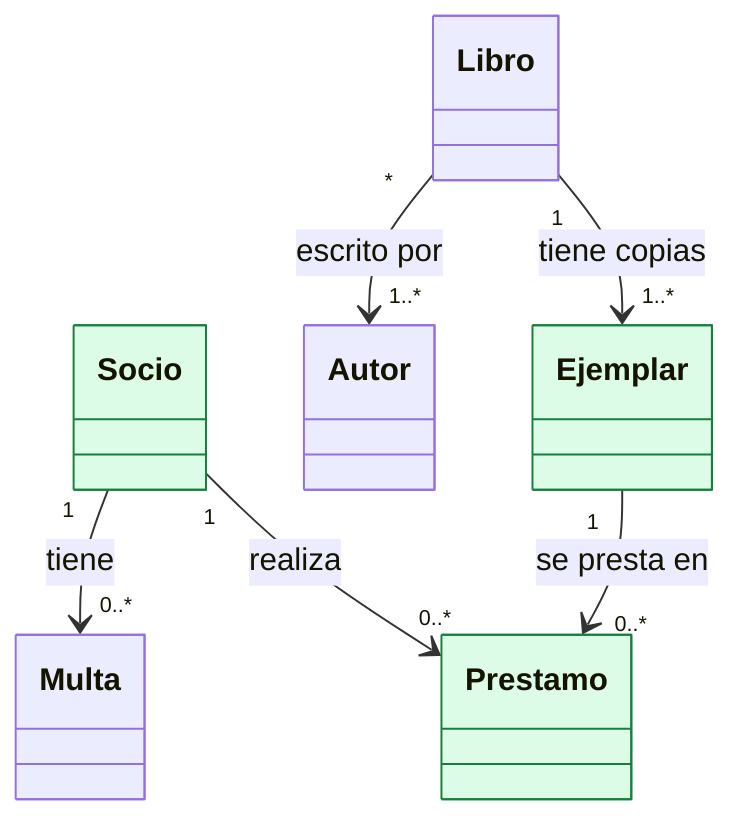
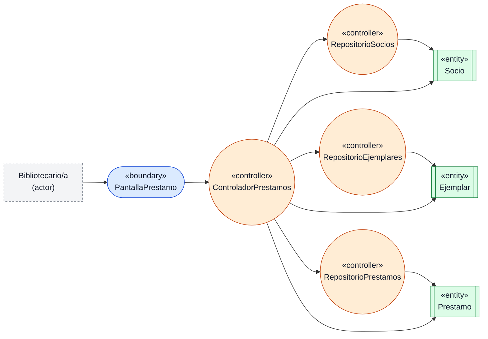
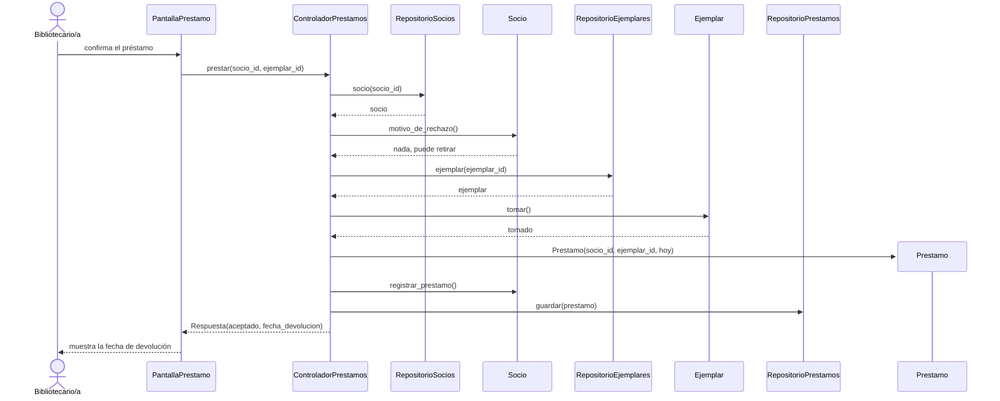
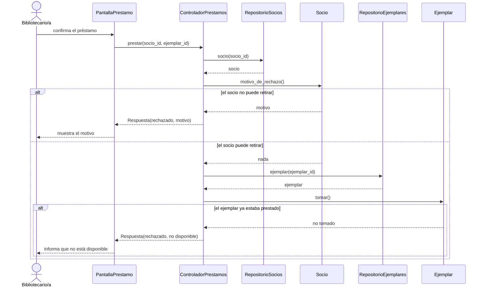
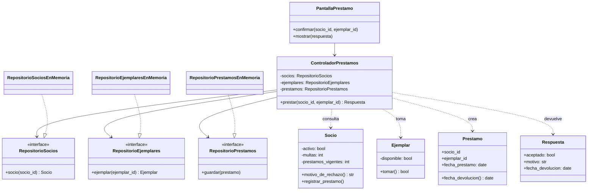

# Ejemplo resuelto de TP4 — "Biblioteca barrial"

> **Qué es este documento.** Un ejemplo completo de cómo un grupo podría resolver el TP4 siguiendo la [consigna](index.md) y la [guía de referencia](referencia.md). Usa un sistema ficticio y cotidiano para mostrar el nivel de detalle esperado en cada artefacto. No es una plantilla para copiar: cada grupo debe trabajar con su propio proyecto, su propia HU y su propia arquitectura. Los títulos coinciden con los pasos de la consigna.

El sistema es una **biblioteca barrial** ficticia. No continúa el ejemplo de los TP anteriores: se supone un TP3 mínimo (aplicación web, API y base de datos, con patrón de capas en la API) para mostrar cómo se conectan los pasos.

## Paso 1 — Ficha de la HU

**HU-03 · Prestar un ejemplar a un socio** (deriva de `CU-02`, slice B). Como bibliotecario/a, quiero registrar el préstamo de un ejemplar a un socio, para controlar qué libros están afuera y cuándo deben volver.

Criterios de aceptación:

- Given un socio activo, sin multas y con menos de 3 préstamos vigentes, y un ejemplar disponible, When el bibliotecario/a confirma el préstamo, Then el sistema registra el préstamo, marca el ejemplar como no disponible y muestra la fecha de devolución (14 días después).
- Given un socio con multas pendientes, inactivo o con 3 préstamos vigentes, When el bibliotecario/a confirma el préstamo, Then el sistema lo rechaza e informa el motivo.
- Given un ejemplar que ya está prestado (incluso por otro bibliotecario/a al mismo tiempo), When el bibliotecario/a confirma el préstamo, Then el sistema lo rechaza e informa que el ejemplar no está disponible.

**Tabla de coherencia** (con el TP3 supuesto de este ejemplo: aplicación web, API y base de datos, con patrón de capas en la API):

| Dimensión | Contenido |
|---|---|
| Funcionalidad | `HU-03` Prestar un ejemplar; camino principal y dos rechazos (socio no habilitado, ejemplar no disponible) |
| Estructura | Contenedor API, componentes «Controladores», «Servicio de préstamos» y «Acceso a datos»; patrón de capas |
| Calidad | `EC-02` integridad: dos préstamos simultáneos del mismo ejemplar. Medida: 0 ejemplares con dos préstamos vigentes en 100 intentos simultáneos. Táctica: operación atómica y transacción en el acceso a datos (`DA-02`) |
| Dominio | Entidades del modelo del TP1 que intervienen: `Socio`, `Ejemplar` y `Prestamo` (ver abajo) |
| Verificación | Prueba con 20 pedidos simultáneos del mismo ejemplar: solo uno se concreta |

**Entidades del modelo de dominio que intervienen.** Este es el modelo de dominio supuesto del TP1; en verde, las entidades que "pegan" con la HU:



| Entidad del modelo (TP1) | ¿Interviene? | Qué usa la HU de ella | La HU la... |
|---|---|---|---|
| `Socio` | Sí | Si está activo, sus multas pendientes y sus préstamos vigentes (con eso decide si puede retirar) | Consulta y modifica (suma un préstamo) |
| `Ejemplar` | Sí | Si está disponible | Consulta y modifica (lo marca como prestado) |
| `Prestamo` | Sí | Fecha de préstamo y de devolución | Crea |
| `Multa` | No | La HU solo necesita saber si hay multas pendientes, dato que expone `Socio` | — |
| `Libro` | No | El préstamo es de un ejemplar concreto; el título no interviene en la lógica | — |
| `Autor` | No | No se usa | — |

En este ejemplo el modelo de dominio no necesitó cambios. Si la HU hubiera pedido, por ejemplo, conservar el historial de renovaciones de un préstamo, se agregaría esa entidad al modelo del TP1 y se anotaría el cambio.

## Paso 2 — Análisis tridimensional

| Dimensión | Elemento | Detalle |
|---|---|---|
| Funcionalidad | Criterio 1 | Si el socio puede retirar y el ejemplar está libre, registrar el préstamo y mostrar la fecha de devolución |
| Funcionalidad | Criterio 2 | Si el socio no puede retirar (inactivo, con multas o en el límite de préstamos), rechazar e informar el motivo |
| Funcionalidad | Criterio 3 | Si el ejemplar ya está prestado, rechazar e informar que no está disponible |
| Estructura | Frontera | Pantalla de préstamo |
| Estructura | Control | Un controlador de préstamos y los repositorios de socios, ejemplares y préstamos |
| Estructura | Dominio | `Socio` (sabe si puede retirar), `Ejemplar` (sabe si está disponible) y `Prestamo` (sabe cuándo vence) |
| Calidad | `EC-02` | Dos préstamos simultáneos del mismo ejemplar: solo uno se concreta |

## Paso 3 — Diagrama de robustez

Leyenda: borde punteado = actor; rectángulo redondeado azul = boundary; círculo naranja = controller; rectángulo con barras verde = entity.



Las tres entidades salen de la tabla del paso 1. Se verifican las reglas de conexión (Referencia, Paso 3): el actor solo toca la pantalla, la pantalla solo toca al controlador, y ninguna entidad se accede desde una frontera. Cada elemento pertenece a un componente del TP3: la pantalla a la aplicación web, el controlador y las entidades a «Servicio de préstamos» y los repositorios a «Acceso a datos».

## Paso 4 — Diagramas de secuencia

Se dibujan dos secuencias con los mismos participantes: una para el camino de éxito y otra para los rechazos.

**Secuencia A: camino de éxito**



**Secuencia B: caminos de rechazo**



Asignación de responsabilidades:

| Responsabilidad | Quién | Criterio |
|---|---|---|
| Decidir si el socio puede retirar | `Socio` | Experto en información: conoce sus multas y sus préstamos vigentes |
| Verificar y marcar el ejemplar como prestado en un solo paso | `Ejemplar` | Experto en información; además resuelve `EC-02`, porque la operación es indivisible |
| Calcular la fecha de devolución | `Prestamo` | Experto en información: conoce su fecha de inicio y el plazo |
| Crear el préstamo | `ControladorPrestamos` | Creador: tiene el socio y el ejemplar elegidos |
| Coordinar el flujo | `ControladorPrestamos` | Controlador |
| Obtener y guardar | Repositorios | Alta cohesión y bajo acoplamiento: el controlador no sabe cómo se guarda |

## Paso 5 — Modelo de clases



## Código (fragmento)

El ejemplo está en Python, pero nada del diseño depende del lenguaje: las clases, las interfaces y las pruebas se escriben igual en Java, JavaScript, C# u otro.

```python
# src/aplicacion/controlador_prestamos.py
class ControladorPrestamos:
    def __init__(self, socios, ejemplares, prestamos, hoy=date.today):
        self._socios = socios
        self._ejemplares = ejemplares
        self._prestamos = prestamos
        self._hoy = hoy

    def prestar(self, socio_id: str, ejemplar_id: str) -> Respuesta:
        socio = self._socios.socio(socio_id)
        motivo = socio.motivo_de_rechazo()
        if motivo:
            return Respuesta(False, motivo)
        ejemplar = self._ejemplares.ejemplar(ejemplar_id)
        if not ejemplar.tomar():
            return Respuesta(False, "el ejemplar no está disponible")
        prestamo = Prestamo(socio_id, ejemplar_id, self._hoy())
        socio.registrar_prestamo()
        self._prestamos.guardar(prestamo)
        return Respuesta(True, None, prestamo.fecha_devolucion)
```

```python
# src/dominio/ejemplar.py
class Ejemplar:
    def __init__(self, id: str, titulo: str):
        self.id, self.titulo = id, titulo
        self._disponible = True
        self._lock = Lock()

    def tomar(self) -> bool:
        with self._lock:                # verifica y marca en un solo paso (EC-02)
            if not self._disponible:
                return False
            self._disponible = False
            return True
```

## Trazabilidad y pruebas

| Criterio / escenario | Caso de prueba | Prueba |
|---|---|---|
| Criterio 1 | `CP-01` | `test_presta_el_ejemplar_y_fija_la_fecha_de_devolucion` |
| Criterio 2, multas | `CP-02` | `test_rechaza_al_socio_con_multas_y_el_ejemplar_sigue_disponible` |
| Criterio 2, límite | `CP-03` | `test_rechaza_al_socio_que_alcanzo_el_limite` |
| Criterio 2, borde | `CP-04` | `test_en_el_borde_con_dos_prestamos_todavia_puede_retirar` |
| Criterio 3 | `CP-05` | `test_rechaza_si_el_ejemplar_ya_esta_prestado` |
| `EC-02` | `CP-06` | `test_dos_prestamos_simultaneos_del_mismo_ejemplar_solo_concretan_uno` |
