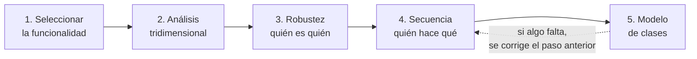

# Ingeniería del Software - 2026 - TP 4

## Referencia teórica: cómo se hace el diseño, la implementación y las pruebas

> **Qué es este documento.** Es el apoyo conceptual de la [consigna del TP4](tp4-consigna.md): explica qué es cada artefacto, qué reglas debe respetar y cómo se construye. No dice qué hay que entregar (eso está en la consigna) ni muestra un caso completo (eso está en el [ejemplo resuelto](tp4-ejemplo.md)). Sigue el mismo orden que la consigna: cada sección se llama como el paso o la parte que explica. Los ejemplos usan una biblioteca barrial ficticia.

---

## Visión general: el recorrido por pasos

El diseño detallado se hace sobre la **historia de usuario elegida**, en cinco pasos, más una verificación final de coherencia. Cada paso produce un resultado que el siguiente transforma:



| Paso | Pregunta que responde | Resultado |
|---|---|---|
| 1. Seleccionar la funcionalidad | ¿Qué HU se diseña y qué dice su criterio de aceptación? | HU elegida, con su relación con el TP3 |
| 2. Análisis tridimensional | ¿Qué hace, con qué se hace y qué propiedades debe cumplir? | Tabla de las tres dimensiones |
| 3. Diagrama de robustez | ¿Qué elementos intervienen y de qué tipo son? | Diagrama de robustez |
| 4. Diagrama de secuencia | ¿En qué orden colaboran y quién tiene cada responsabilidad? | Diagrama de secuencia |
| 5. Modelo de clases | ¿Qué clases, atributos, operaciones y relaciones hacen falta? | Diagrama de clases |

Los pasos 3, 4 y 5 se hacen en ese orden porque cada diagrama se deriva del anterior: **lo que no aparece en el diagrama de secuencia no aparece en el de clases**, y lo que no aparece en el de robustez no se invoca en el de secuencia. Si al dibujar un diagrama el grupo descubre que falta algo, vuelve al anterior y lo corrige.

---

## Paso 1 — Ficha de la HU

La ficha reúne en un solo lugar lo que ya se sabe de la HU (su enunciado y sus criterios de aceptación del TP1) y de su lugar en la arquitectura. Es la base de los pasos siguientes porque obliga a mirar, desde el principio, las tres dimensiones y el modelo de dominio. Los datos que la componen son:

- De qué caso de uso o slice proviene la HU.
- Qué escenario de calidad (`EC-xx`) la condiciona, qué táctica lo resuelve y qué decisión de arquitectura (`DA-xx`) la respalda.
- Qué estilo y patrones del TP3 rigen en el contenedor donde se ejecuta.
- Qué componentes de la vista de componentes del TP3 atraviesa, en qué capa está cada uno y cuál de ellos es el principal (por ejemplo, "Servicio de análisis" del contenedor API).
- Qué **entidades del modelo de dominio** del TP1 intervienen en la HU (ver más abajo).

Estos datos se reúnen en una **tabla de coherencia**, que es el primer producto de la HU y la base de los pasos siguientes:

| Dimensión | Qué se completa | Ejemplo (biblioteca) |
|---|---|---|
| Funcionalidad | HU, caso de uso o slice, y caminos de los criterios | `HU-03` Prestar un ejemplar; camino principal y rechazos (socio no habilitado, ejemplar no disponible) |
| Estructura | Componentes que atraviesa, capas, estilo y patrones | «Controladores», «Servicio de préstamos» y «Acceso a datos» del contenedor API; patrón de capas |
| Calidad | `EC-xx`, táctica y `DA-xx` | `EC-02` préstamos simultáneos del mismo ejemplar; operación atómica y transacción en el acceso a datos (`DA-02`) |
| Dominio | Entidades del modelo del TP1 que intervienen y qué usa la HU de cada una | `Socio`, `Ejemplar` y `Prestamo`; no intervienen `Libro`, `Autor` ni `Multa` |
| Verificación | Cómo se comprueba la medida del escenario | Prueba con pedidos simultáneos del mismo ejemplar |

**Entidades del modelo de dominio que intervienen en la HU.** Este punto es central: el diseño detallado no reemplaza el modelado de dominio, sino que parte de los datos, las reglas y los conceptos del negocio que el grupo ya identificó en el TP1 y decide quién hace qué con ellos. Para la HU elegida, el grupo identifica qué entidades del diagrama de dominio **"pegan" con ella**, es decir, cuáles aparecen en sus criterios de aceptación o hacen falta para cumplirlos. Se sugiere este procedimiento:

1. Marcar los sustantivos del enunciado y de los criterios Given-When-Then.
2. Buscar cada uno en el diagrama de dominio del TP1 e identificar qué entidad le corresponde.
3. Para cada entidad que interviene, anotar qué usa la HU de ella (atributos, reglas, relaciones con otras entidades que intervienen) y si la HU la crea, la consulta o la modifica.
4. Revisar las entidades del modelo que no intervienen y explicar por qué: porque la HU no las usa, o porque alcanza con un dato que expone otra entidad.
5. Si la HU necesita un concepto, un atributo o una relación que el modelo no tiene, se agrega al modelo de dominio del TP1 y se documenta el cambio.

El resultado es una tabla, con una fila por cada entidad del modelo que se haya considerado:

| Entidad del modelo (TP1) | ¿Interviene? | Qué usa la HU de ella | La HU la... |
|---|---|---|---|
| `Socio` | Sí | Si está activo, sus multas pendientes y sus préstamos vigentes | Consulta y modifica |
| `Libro` | No | No interviene en la lógica del préstamo | — |

Las entidades de esta tabla son las que se llevan al diagrama de robustez (Paso 3). El ejemplo resuelto muestra la tabla completa.

---

## Paso 2 — Análisis tridimensional

El diseño de una funcionalidad se mira desde tres dimensiones. Cada una aporta información distinta y ninguna reemplaza a las otras:

| Dimensión | Pregunta | Fuente | Ejemplo |
|---|---|---|---|
| Funcionalidad | ¿Qué debe hacer el sistema para el usuario? | Criterios de aceptación de la HU | "Si el socio tiene multas, rechazar el préstamo e informar el motivo" |
| Estructura | ¿Qué elementos (pantallas, lógica, datos, sistemas externos) hacen falta? | Componente C4 y modelo de dominio | Una pantalla, un controlador, las entidades `Socio` y `Ejemplar`, un repositorio |
| Calidad | ¿Qué propiedades debe cumplir esta funcionalidad? | Escenarios `EC-xx` del TP2 y decisiones del TP3 | "Dos préstamos simultáneos del mismo ejemplar: solo uno se concreta" (`EC-02`) |

El resultado es una tabla con una fila por cada criterio de aceptación y por cada escenario de calidad que la alcanza. La dimensión de calidad es la que conecta este TP con el anterior: **las propiedades de calidad que el TP3 resolvió a nivel de estructura global ahora se resuelven en operaciones concretas** (por ejemplo, una operación que verifica y descuenta en un solo paso para que no haya inconsistencias). Una HU sin ninguna propiedad de calidad asociada es válida, pero el grupo debe poder explicar por qué.

---

## Paso 3 — Diagrama de robustez

El diagrama de robustez es un puente entre lo que pide la HU y el diseño de clases. Clasifica cada elemento que interviene en tres tipos:

| Tipo | Qué representa | Ejemplos |
|---|---|---|
| **Boundary** (frontera) | Lo que conecta el sistema con un actor o con otro sistema: pantallas, interfaces hacia servicios externos | Pantalla de préstamo; conexión con un servicio de avisos por correo |
| **Controller** (controlador) | Coordina la ejecución de la funcionalidad: decide qué se hace y en qué orden | Controlador de préstamos; repositorios |
| **Entity** (entidad) | Un concepto del dominio, con sus datos y reglas | Socio; ejemplar; préstamo |

**De dónde salen las entidades.** Las entidades del diagrama de robustez no se inventan: son las que el grupo identificó en el paso 1 como entidades del modelo de dominio que intervienen en la HU. Si al dibujar el diagrama aparece una entidad que no está en esa tabla, hay dos salidas: se corrige el diagrama o se agrega la entidad al modelo de dominio y se documenta.

**Reglas de conexión:**

| Desde | Hacia | ¿Permitido? | Por qué |
|---|---|---|---|
| Actor | Boundary | Sí | El actor solo interactúa a través de interfaces |
| Boundary | Controller | Sí | La frontera delega la lógica en el controlador |
| Controller | Entity | Sí | El controlador manipula los datos del dominio |
| Controller | Controller | Sí | Los controladores se coordinan entre sí |
| Boundary | Entity | **No** | Rompe la separación de capas |
| Actor | Entity o Controller | **No** | El actor no accede directamente a los datos ni a la lógica |

Cuando aparece una conexión no permitida, es señal de una responsabilidad mal ubicada o de que falta un elemento intermedio (casi siempre, un controlador). Un controlador puede apoyarse en otros controladores (en el ejemplo, los repositorios) y en fronteras hacia sistemas externos (por ejemplo, un servicio de avisos por correo). Lo que no se admite es que acceda a un sistema externo sin pasar por una frontera.

**La decisión clave: dónde vive cada regla.** Cada regla del negocio que aparece en los criterios de la HU (por ejemplo, "un socio con multas no puede retirar un libro") tiene que vivir en algún lugar, y la robustez es el momento de decidirlo. Hay tres candidatos:

| Opción | Dónde se valida | Problema |
|---|---|---|
| A | En la pantalla (boundary) | Es una frontera que decide: si mañana hay otra pantalla o una API, la regla se duplica o se pierde |
| B | En el controlador | Funciona, pero con muchas reglas el controlador engorda y se vuelve obeso |
| C | En la entidad | La entidad sabe qué es estar en condiciones y no se puede saltear: cualquier camino que llegue a ella pasa por la regla |

La opción C suele ser la mejor por tres razones: la entidad tiene la información necesaria (criterio Experto), la regla no se puede saltear y no pueden existir estados inválidos. La pantalla puede avisar antes, lo que mejora la usabilidad, pero no reemplaza la regla del dominio: **la pantalla ayuda, el dominio garantiza**. El grupo indica en el documento, para cada regla de su HU, dónde vive y por qué.

**Coherencia con la estructura.** Cada elemento del diagrama debe poder asignarse a uno de los componentes de la ficha (tabla de coherencia del Paso 1) y a su capa. Un elemento que no pertenece a ningún componente es una alerta: o el elemento sobra, o falta un componente en la arquitectura. Las conexiones deben respetar las restricciones del estilo y de los patrones que rigen el contenedor (por ejemplo, en una arquitectura en capas, ninguna capa depende de las superiores ni se saltea una capa).

**Notación.** Mermaid no tiene un tipo de diagrama de robustez; se dibuja con `flowchart` y una leyenda, como se hizo con el diagrama de flujo de datos del TP1. Se sugiere usar la forma redondeada para boundary, el círculo para controller y el rectángulo con barras para entity, y colores distintos para que se distingan. Los nombres se escriben con el tipo entre comillas angulares (`«boundary»`). El ejemplo resuelto muestra un diagrama completo.

**Cómo se construye, en seis pasos.**

1. Leer la HU y detectar las acciones y los actores.
2. Boundaries: todo lo que habla con los actores o con otros sistemas.
3. Entities: los sustantivos del dominio (los de la tabla del paso 1).
4. Controllers: los verbos que requieren lógica.
5. Conectar los elementos según las reglas de conexión.
6. Revisar que nada quede fuera de su lugar.

Si lleva más de 10 minutos, se está sobrediseñando.

**Errores típicos.**

| Error | Qué pasa |
|---|---|
| Boundaries que deciden | Si la pantalla empieza a validar reglas o a buscar datos, la arquitectura desaparece |
| Controllers obesos | Si el controlador hace todo, concentra la lógica y se vuelve imposible de mantener |
| Entities que procesan | Las entidades pueden verificar su propia integridad, pero no coordinar operaciones |
| Entidades anémicas | Si las entidades no tienen comportamiento propio, el dominio se vacía y todo queda en el controlador |

---

## Paso 4 — Diagrama de secuencia

El diagrama de secuencia muestra, en orden, qué mensajes se envían los elementos del diagrama de robustez para cumplir el criterio de aceptación. Es donde se **asignan las responsabilidades**: cada mensaje es una operación que algún objeto debe tener.

Reglas:

- Los participantes son los elementos del diagrama de robustez (más el actor). No se agregan elementos nuevos sin volver a robustez.
- Se dibuja una secuencia por **camino** que piden los criterios de aceptación: una para el flujo principal y otra para los rechazos (por ejemplo, el rechazo porque el socio tiene multas). Todas usan los mismos participantes de la robustez. Con `alt` u `opt` se muestran las variantes pequeñas dentro de un mismo camino.
- Los mensajes son llamadas con nombre y parámetros reales (`tomar()`, `motivo_de_rechazo()`), no frases ("verifica si está libre").
- Cada mensaje entre elementos de **componentes distintos** debe existir en el catálogo de relaciones de la vista de componentes del TP3. Si no existe, hay dos salidas: se corrige el diseño o se actualiza el TP3, porque la arquitectura estaba incompleta. En ese caso se documenta el cambio.
- La **táctica** del escenario de calidad de la ficha debe verse en el diagrama como una operación o un mensaje concreto (por ejemplo, una transacción, una verificación previa o una llamada a la auditoría).

**Cómo se lee el diagrama.**

| Elemento | Qué significa |
|---|---|
| Participante | Un objeto o actor; aparece arriba, en su caja |
| Línea de vida | La vertical punteada: la existencia del participante durante la operación |
| Mensaje | Flecha sólida: una llamada a una operación, que espera respuesta |
| Retorno | Flecha punteada: un valor o una confirmación |
| Tiempo | Corre de arriba hacia abajo: lo de arriba ocurre antes |
| Fragmento | Un recuadro con una condición: `alt` (camino alternativo), `opt` (paso opcional) o `loop` (paso que se repite) |

Regla práctica: cada diagrama entra en una pantalla. Si tiene 50 mensajes, no se está modelando una historia sino un sprint. Además, ninguna frontera decide, y cada mensaje tiene un responsable.

**Cómo decidir qué objeto hace cada cosa.** Se aplican los criterios GRASP (patrones generales para asignar responsabilidades). Los cinco que se usan en este TP:

| Criterio | La pregunta | Regla | Ejemplo |
|---|---|---|---|
| Experto en información | ¿Quién tiene la información? | La responsabilidad se asigna a la clase que tiene los datos necesarios | `Socio` decide si puede retirar, porque conoce sus multas y sus préstamos vigentes |
| Creador | ¿Quién crea la instancia? | Crea un objeto quien lo contiene, lo usa de forma directa o tiene los datos para iniciarlo | El controlador crea el `Prestamo`, porque tiene el socio y el ejemplar elegidos |
| Controlador | ¿Quién orquesta el pedido que llega de la interfaz? | Un objeto recibe y coordina el evento del sistema, sin hacer él mismo el trabajo del dominio | `ControladorPrestamos` coordina; no decide si el socio puede retirar ni guarda |
| Bajo acoplamiento | ¿Cómo evito que un objeto conozca detalles ajenos? | Se prefiere la asignación que genera menos dependencias entre clases | La pantalla conoce solo al controlador |
| Alta cohesión | ¿Cada clase hace una sola cosa bien? | Cada clase concentra responsabilidades relacionadas entre sí | Los repositorios solo guardan y recuperan |

**Cuando un dato pertenece a otro módulo o sistema.** Si para cumplir la HU hace falta un dato que no es de nuestro módulo (por ejemplo, saber si un docente está asignado a una materia, algo que sabe otro módulo), no hay una entidad propia que lo represente. Se modela como una **frontera hacia ese módulo**: una interfaz que el controlador usa para preguntar, sin saber cómo el otro módulo guarda sus datos. Así se mantiene el bajo acoplamiento entre módulos.

**Checklist para validar la secuencia.**

- ¿Cada mensaje tiene un responsable lógico?
- ¿Hay pasos implícitos que no están modelados?
- ¿La frontera evita tomar decisiones?
- ¿El controlador coordina sin ahogarse?
- ¿Las entidades mantienen la coherencia del dominio?
- ¿El flujo es claro de principio a fin, y hay un camino de error?

---

## Paso 5 — Modelo de clases

El diagrama de clases no se inventa: se descubre a partir de la secuencia. El método es casi mecánico:

1. Cada participante de la secuencia pasa a ser una clase o una interfaz.
2. Cada mensaje que recibe pasa a ser una operación de esa clase.
3. La información que necesita para cumplir su tarea son sus atributos.
4. Las líneas del modelo (dependencias y asociaciones) surgen de la colaboración entre las clases.

**Lo que no aparece en la secuencia no aparece en el modelo de clases, y al revés: si aparece en el modelo, tiene que tener respaldo en el comportamiento.**

Reglas:

- Cada clase incluye los atributos y las operaciones que el diagrama de secuencia usa, con sus tipos. No se agregan operaciones "por si acaso".
- Los repositorios y las conexiones hacia sistemas externos se modelan como **interfaces**; la clase concreta (en memoria, simulada) aparece aparte y las implementa. Esto permite reemplazar la persistencia real sin tocar el controlador.
- Las relaciones indican su tipo: asociación, dependencia (`..>`), realización de interfaz (`..|>`), herencia y composición. Se indica la multiplicidad cuando importa.
- Las clases de dominio conservan los nombres y las relaciones del modelo de dominio del TP1. Si el diseño necesita cambiar algo (un nombre, una relación o una clase nueva), el cambio se documenta y el modelo del TP1 se actualiza.
- El diagrama de clases es **uno solo** y reúne lo que aparece en todas las secuencias de la HU (éxito y rechazos).

Para validar el modelo, se lo recorre como si se fuera el usuario y como si se fuera el sistema: ¿cada clase cumple un rol claro?, ¿cada método tiene una razón de existir?, ¿alguna clase conoce detalles técnicos que no le corresponden?

---

## Justificación del diseño

Terminado el modelo de clases, el grupo justifica su diseño en el documento: para las clases principales, indica qué responsabilidad tiene cada una y con qué criterio GRASP se la asignó (la tabla de asignación del Paso 4 sirve de base), y explica las decisiones de diseño que tomó (por ejemplo, por qué hay una interfaz en ese lugar o por qué una regla vive en una entidad y no en el controlador).

La justificación tiene que ser honesta: más clases e interfaces tienen un costo (más indirección), y el grupo debe poder explicar cuándo ese costo vale la pena y cuándo no. Una clase de tres líneas con una sola implementación posible no necesita una interfaz solo porque el diagrama quede más prolijo.

**Patrones de diseño (opcional).** Si el diseño usa un patrón de los vistos en clase (por ejemplo, Strategy para variantes de cálculo, Factory para crear según un tipo, Repository para el acceso a datos), el grupo lo nombra, indica el problema que resuelve y señala dónde está en el diagrama de clases. No se pide usar patrones por obligación: un patrón que no resuelve un problema concreto del diseño empeora la nota, no la mejora.

---

## Coherencia con la arquitectura y trazabilidad

Antes de cerrar la Parte A, se comprueba que las tres dimensiones de la tabla de coherencia (Paso 1) quedaron reflejadas en el diseño. Esa verificación consiste en responder, con evidencia, siete preguntas: si cada participante de las secuencias pertenece a un componente de la ficha, si cada mensaje entre componentes está en el catálogo de relaciones del TP3, si el diseño respeta las restricciones del estilo y de los patrones, si la táctica del escenario aparece como operación o mensaje, si cada entidad del diagrama de robustez está en el modelo de dominio, si cada entidad que interviene aparece en el diseño y si la medida del escenario tiene una prueba. La tabla para completar está en la consigna.

Las diferencias que aparezcan entre el diseño y el TP3, o entre el diseño y el modelo de dominio del TP1, no son un error del grupo: el diseño se precisa al bajar de nivel. Lo importante es que cada diferencia quede documentada y que el documento anterior se actualice.

**Trazabilidad.** La cadena de trazabilidad del TP3 (escenario → táctica → estilo o patrón → decisión → elemento C4) se extiende con las columnas de diseño, de modo que la HU se pueda seguir hasta el código y la prueba que la verifica: HU → componente C4 → clases → archivo → pruebas. Todo criterio de aceptación debe llegar al menos a una prueba, y toda clase del diagrama debe aparecer en algún diagrama de secuencia. El ejemplo resuelto muestra la tabla completa.

---

## Parte B — Implementación

### Estructura del proyecto

Se sugiere organizar el código en capas que reflejen las reglas del diagrama de robustez, de modo que la estructura de carpetas haga visible el diseño:

```text
src/
├── dominio/            # entidades: Socio, Ejemplar, Prestamo
├── aplicacion/         # controladores e interfaces (puertos)
├── infraestructura/    # repositorios (en memoria o con base real) y servicios simulados
└── interfaz/           # interfaz gráfica mínima (boundary)
tests/
```

### Reglas de implementación

1. **El código sigue al diseño.** Los nombres de clases y operaciones coinciden con los del diagrama de clases. Si al programar el grupo descubre que el diseño estaba mal, corrige primero el diagrama y después el código: al final, ambos deben decir lo mismo.
2. **Dependencias en un solo sentido.** La interfaz gráfica depende de los controladores; los controladores, del dominio y de las interfaces; las implementaciones de infraestructura implementan esas interfaces. El dominio no importa nada de las demás capas.
3. **Los colaboradores se reciben, no se crean.** El controlador recibe sus repositorios y sus conexiones hacia servicios externos por el constructor (inyección de dependencias). Quién arma los objetos concretos es un único lugar, el punto de arranque del programa.
4. **Las reglas del dominio viven en las entidades.** Si el controlador tiene un `if` que verifica una regla del negocio, probablemente esa regla pertenece a una entidad.
5. **Persistencia y servicios externos detrás de interfaces.** La persistencia puede ser una clase en memoria (un diccionario o una lista) o una base de datos real, a elección del grupo; en ambos casos implementa la interfaz del repositorio, y el controlador no cambia. Los servicios externos son clases simuladas que registran qué se les pidió.
6. **Se declaran los tipos** en las firmas de las operaciones públicas, en la medida en que el lenguaje lo permita, para que el código sea legible y coincida con el diagrama.

### Interfaz gráfica mínima

La interfaz gráfica es una frontera (*boundary*) del diagrama de robustez y respeta sus reglas:

- Solo conoce a los controladores. No importa entidades ni repositorios.
- No contiene reglas de negocio: no calcula, no valida reglas del dominio ni decide.
- Muestra lo que el controlador responde, incluidos los rechazos (por ejemplo, el motivo por el que se rechazó un préstamo).

Alcance mínimo: una pantalla o formulario que permita ingresar los datos, ejecutar la operación y ver el resultado. Las pruebas unitarias de la Parte C **no** pasan por la interfaz gráfica: se prueban los controladores y las entidades directamente.

### Cómo se ejecuta

El repositorio incluye en su `README.md` las instrucciones para instalar las dependencias (un archivo `requirements.txt`) y para ejecutar tanto la interfaz como las pruebas, con comandos que funcionen en una máquina limpia. Esto es lo que se usa en la defensa.

---

---

## Parte C — Pruebas unitarias

### Qué es probar software y qué se prueba en este TP

**Probar** es ejecutar el software con datos elegidos para comparar lo que hace con lo que debería hacer, con el objetivo de encontrar defectos. Una prueba no demuestra que el software es correcto: solo puede mostrar que, para esos datos, se comporta como se espera o que falla. Tres términos que conviene distinguir:

| Término | Qué es |
|---|---|
| Caso de prueba | Una combinación de datos de entrada, estado inicial y resultado esperado |
| Oráculo | Lo que permite saber cuál es el resultado esperado (en este TP, los criterios de aceptación y las reglas del dominio) |
| Defecto | Un error en el código que puede producir una falla cuando se ejecuta en ciertas condiciones |

Las pruebas se organizan en **niveles**, según qué parte del sistema se ejercita:

| Nivel | Qué verifica | En este TP |
|---|---|---|
| Unitario | Una unidad pequeña (una operación de una entidad, un método de un controlador) de forma aislada | **Es el nivel de este TP** |
| De integración | Que varias unidades funcionen bien juntas (por ejemplo, el repositorio con la base real) | Opcional: solo tiene sentido si el grupo usa una base de datos real y quiere probar el repositorio contra ella |
| De sistema y de aceptación | El sistema completo desde el punto de vista del usuario | Se muestra en la demostración con la interfaz gráfica, pero no se automatiza |

Se prueban las clases de dominio y los controladores. Los colaboradores del controlador (repositorios, servicios externos) son implementaciones en memoria o simuladas: gracias a que el controlador depende de interfaces, la prueba no necesita base de datos ni servicios reales, aunque la aplicación use una base real. Estas implementaciones simuladas se llaman **dobles de prueba**: reemplazan a un colaborador real para controlar la prueba (por ejemplo, un repositorio en memoria que devuelve lo que se necesita, o un servicio simulado que registra qué se le pidió).

### Diseño de casos de prueba

Los casos de prueba se diseñan **antes** de escribirlos y se registran en una tabla, con dos técnicas complementarias.

**Caja negra.** Se diseñan mirando solo la especificación, sin leer el código. La fuente son los criterios de aceptación de la HU. Para cada criterio se escribe al menos un caso. Tres técnicas ayudan a elegir los datos:

| Técnica | Idea | Ejemplo (préstamo de un libro) |
|---|---|---|
| Partición en clases de equivalencia | Se divide cada entrada en grupos de valores que el sistema trata igual, y se prueba un valor de cada grupo | Socios: activo sin multas, con multas, inactivo. Basta un socio de cada clase |
| Valores límite | Los errores aparecen en los bordes de los rangos: se prueba justo en el borde, uno por debajo y uno por encima | Límite de 3 préstamos: socios con 2 préstamos (puede), 3 (no puede) y 4 |
| Tabla de decisión | Cuando varias condiciones se combinan, se arma una tabla con las combinaciones y el resultado de cada una | Activo, sin multas y por debajo del límite: acepta. Si falla cualquiera de las tres, rechaza con su motivo |

**Caja blanca.** Se diseñan mirando el código. El objetivo es que las pruebas recorran lo que el código puede hacer. Hay tres niveles de exigencia:

| Cobertura | Qué pide | Qué descubre |
|---|---|---|
| De sentencias | Que cada línea se ejecute al menos una vez | Código que nunca se ejecuta |
| De decisiones (ramas) | Que cada `if` se pruebe con resultado verdadero y con resultado falso | Ramas que nadie probó |
| De caminos | Que se recorran las combinaciones de decisiones | Interacciones entre decisiones; es muy costosa y se aplica solo a lo crítico |

Este análisis puede mostrar casos que los criterios de aceptación no contemplan.

| ID | Técnica | Origen | Dado (entrada y estado) | Resultado esperado |
|---|---|---|---|---|
| `CP-01` | Caja negra | `HU-03`, criterio 1 | Socio activo sin multas y con 0 préstamos; ejemplar libre | Aceptado, fecha de devolución 14 días después, ejemplar no disponible, un préstamo guardado |
| `CP-02` | Caja negra | `HU-03`, criterio 2 | Socio con una multa pendiente | Rechazado e informa las multas; el ejemplar sigue disponible y no se guarda nada |
| `CP-04` | Caja negra, límite | `HU-03`, criterio 2 | Socio con 2 préstamos vigentes (uno menos que el límite) | Aceptado |
| `CP-06` | Caja blanca | `Ejemplar.tomar`, rama de rechazo | 20 pedidos simultáneos del mismo ejemplar libre | Solo uno lo toma; los demás son rechazados (`EC-02`) |

### Estructura de una prueba

Cada prueba sigue la estructura de los criterios de aceptación del TP1: se prepara el estado inicial (*Given*), se ejecuta la operación (*When*) y se verifica el resultado (*Then*). El nombre de la prueba dice qué comportamiento verifica, no qué método llama. El ejemplo está en Python con pytest:

```python
def test_rechaza_al_socio_con_multas_y_el_ejemplar_sigue_disponible():
    controlador, ejemplar, prestamos = armar(Socio("s1", multas=1))   # Given
    r = controlador.prestar("s1", "e1")                               # When
    assert not r.aceptado and "multas" in r.motivo                    # Then
    assert ejemplar.disponible and prestamos.guardados == []
```

Reglas: una prueba verifica un solo comportamiento; no depende de otra ni del orden de ejecución; no usa la interfaz gráfica, la red ni el reloj del sistema sin controlarlo.

### Ejecución y cobertura

Se ejecutan las pruebas con el framework elegido y se genera el reporte de cobertura con la herramienta correspondiente de ese lenguaje. Por ejemplo, en Python con pytest y el complemento `pytest-cov`:

```bash
pip install pytest pytest-cov
pytest --cov=src --cov-report=term-missing
```

La **cobertura** indica qué porcentaje del código se ejecutó durante las pruebas (según la herramienta, de líneas o de ramas). Los reportes suelen listar, además, lo que no se ejecutó (en el ejemplo, con `term-missing`). El reporte se acompaña de un breve análisis que responde:

- Qué líneas o ramas no quedaron cubiertas y por qué (código de la interfaz gráfica, código que no se pudo probar, falta de tiempo).
- Qué pruebas adicionales se escribieron al ver el reporte.
- Si hubo pruebas que pasan pero verifican poco.

Una cobertura alta no prueba que el código sea correcto: dice qué se ejecutó, no qué se verificó. Se sugiere apuntar a una cobertura de alrededor del 80 % sobre dominio y controladores, y se valora más un reporte analizado que un porcentaje alto sin análisis. La interfaz gráfica se puede excluir del cálculo, indicándolo.

### Complejidad ciclomática

**A definir.** La forma en que se usa en la entrega se presenta en la clase del 10/11. Hasta entonces no se pide nada sobre este tema. Lo que sigue es material de apoyo.

**Qué mide.** La complejidad ciclomática de una operación es la cantidad de caminos independientes que tiene el código. Se calcula como la cantidad de decisiones (`if`, ciclos, condiciones combinadas con "y" u "o", casos de un `switch` y manejadores de excepciones) más uno. Sirve para dos cosas:

- **Estimar el esfuerzo de prueba:** es la cantidad mínima de casos de prueba necesaria para cubrir todas las ramas de la operación.
- **Detectar código difícil de entender y de mantener:** como referencia habitual, se considera que una operación con más de 10 conviene dividirla.

| Operación del ejemplo | Decisiones | Complejidad | Casos mínimos |
|---|---|---|---|
| `Socio.motivo_de_rechazo` | 3 (inactivo, con multas, en el límite) | 4 | 4: los tres rechazos y el caso habilitado |
| `ControladorPrestamos.prestar` | 2 (socio rechazado, ejemplar no tomado) | 3 | 3: las dos ramas de rechazo y el éxito |
| `Ejemplar.tomar` | 1 (no disponible) | 2 | 2 |

**Relación con los diagramas.** Cada `alt` o `opt` de un diagrama de secuencia es una decisión en el código. Por eso el diagrama permite estimar la complejidad de un controlador antes de escribirlo, y un controlador con muchas ramas es una señal de que está haciendo trabajo que le corresponde al dominio (controlador obeso).

Existen herramientas que la calculan automáticamente para la mayoría de los lenguajes (por ejemplo, `radon` en Python).

### IA en las pruebas

La IA puede proponer casos de prueba y generar pruebas. El grupo debe verificar que las pruebas generadas verifiquen comportamiento real (una prueba que siempre pasa no sirve), que no repitan el código que prueban, y que los casos propuestos cubran los límites y los datos inválidos. Una buena práctica es dar a la IA el criterio de aceptación y pedirle casos de prueba **antes** de mostrarle el código.

---

---

## Siglas usadas

| Sigla | Significado |
|---|---|
| API | Interfaz de programación de aplicaciones: las operaciones que un programa ofrece a otros |
| C4 | Modelo de documentación de arquitectura en cuatro niveles: contexto, contenedores, componentes y código |
| CP | Caso de prueba |
| DA | Decisión de arquitectura |
| EC | Escenario de calidad |
| GoF | *Gang of Four*: los cuatro autores del libro clásico de patrones de diseño |
| GRASP | Patrones generales para asignar responsabilidades (*general responsibility assignment software patterns*) |
| GWT | Given-When-Then: formato de los criterios de aceptación |
| HU | Historia de usuario |
| IA | Inteligencia artificial |
| TP | Trabajo práctico |
| UML | Lenguaje unificado de modelado |

---

---

## Bibliografía

- Valotto, V. *Diseño tridimensional de software*. 2025. Incluye el material de clase aplicado a un caso real (carga de una pregunta de opción múltiple): análisis de funcionalidad, estructura y calidad; diagramas de robustez, de secuencia y de clases.
- Rosenberg, D. y Stephens, K. *Use Case Driven Object Modeling with UML: Theory and Practice*. Apress, 2007. Antecedente del diagrama de robustez.
- Larman, C. *Applying UML and Patterns: An Introduction to Object-Oriented Analysis and Design and Iterative Development*. Prentice Hall. Referencia para los criterios GRASP.
- Gamma, E., Helm, R., Johnson, R. y Vlissides, J. *Design Patterns: Elements of Reusable Object-Oriented Software*. Addison-Wesley.
- Documentación del framework de pruebas y de la herramienta de cobertura del lenguaje elegido (por ejemplo, pytest y pytest-cov).
